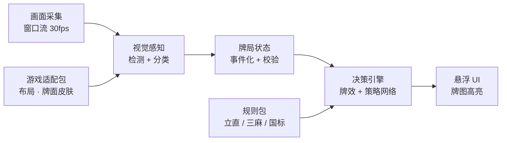

# 麻将 Copilot 设计方案

## 需求

1. 实时监控屏幕上的麻将牌：自己的手牌，以及自己和对手打出过的牌
2. 根据当前牌局给出打牌建议：打哪张，要不要吃、碰、杠
3. 短期适配日本麻将（雀魂、雀姬），长期适配任意三人 / 四人麻将游戏，包括网页版和 Steam 单机版
4. 不操作游戏，只给建议
5. 速度快，在出牌时限内尽早给出建议
6. 界面友好易用
7. 界面实时显示手牌图像和建议（直接标出哪张牌、吃碰杠），而不是用文字
8. 界面实时显示可能胡 / 建议胡的牌型，最多 3 种
9. 开箱即用，不需要繁琐的专业配置
10. 优先离线运行

运行平台：先做 macOS，P2 加入 Windows。

## 一、核心思路

只读屏幕像素：不读游戏内存，不抓网络包，也不注入游戏进程。

已有的开源日麻助手（如 MahjongCopilot、Akagi）走的是网络中间人路线：要装证书、配代理，而且每款游戏都得单独解析协议。这和"开箱即用"、"适配任何麻将游戏"两条需求冲突。纯视觉方案的代价是要自己做好识别，换来三点好处：游戏无关、零配置、不碰游戏程序。

## 二、总体架构

- 应用基于 Tauri 2。采集、感知、状态、决策四段都在同一个 Rust 进程里运行；界面是网页视图，只接收建议结果，画面本身不经过网页。
- 全部在本地运行。
- 游戏适配包和规则包可以替换，接入新游戏只加包，不改核心。

## 三、模块设计

### 1. 画面采集

- 只捕获游戏窗口（Steam 客户端或浏览器窗口都行）：macOS 用 ScreenCaptureKit，Windows（P2）用 Windows.Graphics.Capture。Rust 里按平台各写一个实现，对上层提供同一个接口。我们自己的悬浮窗不会被采进去，所以叠加显示不会干扰识别。
- 以 30fps 采集，但先做变化检测（各区域缩略图做差分），画面没变就不推理，空闲时几乎不耗电。
- 坐标统一换算成相对窗口的比例，窗口缩放、Retina / 高分屏、全屏切换都不需要用户重新设置。

### 2. 视觉感知（分三层）

| 层 | 做什么 | 怎么做 |
|---|---|---|
| 版面定位 | 找出手牌、四家牌河、副露、宝牌指示、按钮、分数等区域 | 已适配的游戏用适配包里的区域模板，加锚点校正；没适配的游戏用通用版面检测模型 |
| 找牌和认牌 | 每张牌的位置、朝向、种类 | 第一步用轻量检测器找出牌框和朝向（横置的牌表示立直或副露来源）。第二步把牌裁出来，先按方位转正，再交给小型分类网络：34 种牌 + 赤五 + 牌背，长期加花牌。模型都导出为 ONNX，用 ONNX Runtime 推理：mac 上走 CoreML（用得上神经网络引擎），Windows 上走 DirectML |
| 数字和按钮 | 局数、本场数、余牌数、分数；吃/碰/杠/和/立直按钮 | 用自带的两个小模型：一个认数字，一个给按钮分类。不依赖系统的识字功能，两个平台通用，也比通用识字更快更准。动作按钮一出现，就是"该做鸣牌决定了"最可靠的信号 |

鲁棒性处理：

- 稳定帧门控：各区域连续 2–3 帧一致才认定结果。摸牌飞行动画、鸣牌特效、雀魂的角色立绘这类帧直接跳过。
- 鼠标悬停时手牌会上浮，检测器要能容忍这种位移。

训练数据：

- 合成数据：多套牌面素材，配上透视、模糊、压缩、光照等变化。
- 牌谱回放自动标注：在游戏里回放已知牌谱，同时录屏。牌谱本身就是标准答案，能自动产出大量带标注的真实截图，这是数据成本最低的办法。

### 3. 牌局状态引擎

- 把逐帧识别结果转成事件流：摸牌、打牌、吃碰杠、立直、翻宝牌、和牌、流局。内部用日麻 AI 的通用事件格式 mjai 协议，现有的 AI 模型可以直接接上。
- 用规则互相校验：
  - 每种牌最多 4 张；
  - 手牌张数 = 13 − 3 × 副露数（摸牌时再 +1）；
  - 牌河只增不减（被鸣走的牌除外）；
  - 宝牌指示只在杠之后增加。
- 拿不准的牌：在 UI 上加一个"?"角标，先按最可能的结果计算，用户点一下就能改。
- 中途打开程序也行：直接从当前画面重建整个牌局，不需要从开局开始看。

### 4. 决策引擎（两层叠加）

规则和搜索层：结果确定、可以解释，所有麻将规则都能用，是兜底。

- 向听数（查表法，微秒级）
- 有效进张，扣掉场上已经看得见的牌
- 役和番符计算、打点估算
- 用蒙特卡洛估算和牌概率
- 防守：现物、筋、壁、one-chance、每张牌的危险度
- 推还是退：比较期望得点和放铳损失
- 吃、碰、杠的判断，就是对比"鸣"和"不鸣"两个分支各自的速度 × 打点 × 安全度

神经策略网络（日麻的主力）：直接用现成的、已训练好的模型，不自己训练。输入牌局状态，输出每个可选动作的评分，单次推理在 10ms 以内。

- 首选基于 Mortal 的模型。Mortal 已经证明这条路线能达到很强的水平，但作者本人不提供权重，所以要找来源和许可都清楚的公开权重。
- Mortal 的代码是 AGPL-3.0。用了它的代码，整个项目就以 AGPL-3.0 开源，我们接受这一点。
- 模型转成 ONNX 在 Rust 里推理。输入编码按原实现复现，并用对照测试保证输出一致。

两层怎么合作：网络负责给动作排序；规则层负责合法性过滤，并提供界面上显示的数字（进张数、危险度、目标牌型）。三麻、国标、四川这类暂时没有网络模型的规则，只靠规则层也能给出靠谱建议。

### 5. 目标牌型（最多 3 种）

1. 从当前手牌出发，在"最多再换 向听数+1 张牌"的范围内，用拆解树搜索枚举所有能和的 14 张组合，边搜边剪枝。
2. 每个组合算两个数：成牌概率 P（看剩余牌数和剩余巡数）、打点 V。
3. 按役种路线分组，比如立直平和、一气通贯、混一色、七对子、对对和。每组只留 P × V 最高的一个，再取前 3 组。
4. 听牌之后切换成"听牌视图"：每张待牌都显示和了后的完整牌型、剩余几张、多少点。
5. 向听数 ≥ 3 时只显示大方向（染手、七对、役牌速攻），不显示具体牌型，以免误导。

### 6. UI 设计

面板从上到下分四块：

| 区块 | 内容 |
|---|---|
| 状态栏 | 识别状态灯、游戏名、局数和本场数、余牌数、宝牌指示牌 |
| 手牌 | 13 张手牌 + 摸到的牌。建议打出的牌红框上浮并带向下箭头；第 2、3 候选在牌下方用色条表示 |
| 鸣牌提示 | 只在对手出牌时出现：对手打出的牌 → 推荐动作（大号 ✓，例如"碰"加上组成的面子）；不推荐的动作灰掉 |
| 目标牌型 | 最多 3 行。每行是完整的 14 张小牌图，还缺的牌用虚线框；右侧是役种标签、点数和成牌概率条 |

示例（自家东 2 局，摸到北）：

- 手牌 1–8 万、3 4 筒、5 索、中中，摸北 → 建议打北，第 2、3 候选为 5 索、3 筒
- 目标牌型
  - A：立直 · 一气通贯，缺 9 万和 5 筒，5200 点，28%
  - B：立直，缺 6 万和 5 筒，1300 点起，41%
  - C：混一色 · 一通 · 中，缺 9 万、中、2 万 ×2，8000 点，9%
- 对家打出中 → 推荐碰

设计要点：

- Tauri 窗口 + 网页界面（React + TypeScript）：无边框、置顶、半透明。mac 上做成不抢焦点的面板（用社区插件 tauri-nspanel，或少量原生代码），点它不会抢走游戏窗口的焦点。
- 两种模式：
  - 侧栏模式：自动吸附在游戏窗口旁边。
  - 叠加模式：一层透明、鼠标可以穿透的覆盖层，直接在游戏画面上给建议的那张牌画红框。它只负责画框，不操作游戏。
- 牌面用程序自带的高清 SVG 牌图，不用截图裁剪，所以清晰一致，而且万红、筒蓝、索绿颜色分明。牌图来自 lietxia/mahjong_graphic（M+ 字体许可，可修改、可商用、可再分发），不用其中的「雀魂样式」文件夹；牌背自己画。
- 信息分层：主建议用红框加箭头，扫一眼就能看到；第 2、3 候选用色条表示；鸣牌提示只在对手出牌时弹出，用大号 ✓ / ✗；有人立直后，手牌下方加一排危险度色条（绿/黄/红）。
- 识别状态灯：绿色表示正常，黄色表示有拿不准的牌，红色表示画面丢失。
- 快捷键（⌥ Space）显示/隐藏，有紧凑模式（只显示一行手牌），支持深浅色主题和中日英三种语言。

## 四、实时性

雀魂每手的基础思考时间只有几秒，所以按"画面稳定后 300ms 内出建议"来设计。下表是延迟预算：

| 环节 | 预算 |
|---|---|
| 等下一帧（30fps） | ≤ 33 ms |
| 稳定帧确认（2 帧） | ~66 ms |
| 找牌 + 认牌 | 10–20 ms |
| 状态更新 + 校验 | < 1 ms |
| 决策（规则 + 网络） | 5–15 ms |
| 目标牌型 | < 30 ms（大多已预先算好） |
| 界面渲染 | ≤ 16 ms |
| 合计 | 约 150 ms，P95 < 300 ms |

画面全程在 Rust 进程里处理，不跨进程拷贝；发给界面的只是几百字节的建议结果。

提速的关键是预计算：

- 对手思考的时候，后台把"下一张可能摸到的 34 种牌"对应的打牌建议都算好；
- 对手一打出牌，马上算好吃/碰/杠/荣和该怎么选。

这样按钮一出现，建议基本同时出现，用户感受到的延迟只剩识别那一段。

## 五、开箱即用 + 离线

- 不加入 Apple Developer Program（不交年费）：app 用自签名证书签名，用 Tauri 的打包工具打成 DMG，拖进"应用程序"即可。模型、牌图、适配包全部内置，体积大约 100MB 级。
- 首次打开：因为没有经过苹果公证，系统会拦截一次。用户在"系统设置 → 隐私与安全性"底部点"仍要打开"并确认，之后就能正常使用。app 被拦截时自己还没运行，所以这三步说明画在 DMG 窗口的背景图上，下载页也写一份。
- 始终用同一张自签名证书签名（不用临时签名），这样屏幕录制权限能跨版本保留。证书导出为 .p12 备份，丢了的话所有用户都要重新授权。
- 以后想去掉首次打开这一步，再加入 Apple Developer Program（个人即可，每年 99 美元），换成开发者证书签名并公证。代价是所有用户需要重新授权一次屏幕录制。
- Windows（P2）：安装包没签名时 SmartScreen 会拦一次，用户点"更多信息 → 仍要运行"即可，下载页写明这一步。
- app 启动后的引导三步：
  1. 授权屏幕录制（有动图指引）；
  2. 自动找到游戏窗口：按应用名、窗口标题、浏览器标签页标题匹配雀魂、雀姬等，找不到就让用户在窗口缩略图里点选；
  3. 开始。
- 自动识别：哪款游戏（视觉特征）、三麻还是四麻、有没有赤宝牌、窗口大小、牌面皮肤。
- 不需要：代理、证书、浏览器插件、Python 环境、账号登录。
- 完全离线：推理和数字、按钮识别都在本机完成，默认不发任何网络请求，截下来的画面不离开电脑。"检查更新"由用户手动开启。
- 系统要求：
  - macOS 14+，Apple Silicon 优先。Intel Mac 也能跑，但延迟会高一些。
  - Windows 10（1903 及以上）；推荐 Windows 11，可以去掉采集时的黄色边框。

## 六、从雀魂到"任意麻将游戏"

把差异收进两类可替换的包里，核心代码不用改：

- 游戏适配包：区域模板、牌面样本、按钮文字、窗口匹配规则，就是一个 JSON 加少量图片。接入一款新游戏就加一个新包。
- 规则包：
  - 牌的组成：花牌、三麻去掉 2–8 万；
  - 手牌张数：台湾麻将 16 张；
  - 可以鸣的动作：四川麻将不能吃；
  - 和牌条件：国标 8 番起和，四川缺一门、血战到底；
  - 计分方式。
- 平台：平台差异只有采集、推理加速、窗口行为三处，都封装在 Rust 的平台模块里。mac 先行，Windows 在 P2。
- 终点：用积累下来的多款游戏数据，训练一个通用的牌桌理解模型。即使没有适配包的游戏，也能退一步给出"手牌牌效建议"。
- 新皮肤：认牌网络用"特征向量 + 原型匹配"的方式，遇到新牌面只要补几十张样本。甚至可以在对局中利用"每种牌最多 4 张"等约束自动归类、自己标注。

## 七、技术栈

| 层 | 选型 |
|---|---|
| 应用框架 | Tauri 2 |
| 界面 | React + TypeScript + Vite，运行在系统网页视图里（mac：WKWebView；Windows：WebView2） |
| 采集 | Rust 平台模块：ScreenCaptureKit（mac）/ Windows.Graphics.Capture（Windows） |
| 推理 | ONNX Runtime（Rust 绑定 ort）：mac 走 CoreML，Windows 走 DirectML，CPU 兜底 |
| 状态 + 决策 | Rust crate，和界面、平台无关 |
| 模型 | 识别模型用 PyTorch 自己训练；决策模型用现成的已训练模型。都导出 / 转换为 ONNX |

为什么选 Tauri 2：

- 原生 Swift 在 mac 上最快、最省资源，但以后做 Windows 要重写界面和采集。
- Electron 只统一了界面：采集、推理加速、识字仍要写原生插件；还要多带一个 Chromium（安装包大 100MB 以上，内存占用高）；每帧画面也要多次跨进程拷贝。
- Tauri 2 的界面同样用网页写，但整条流水线留在 Rust 里，安装包只多几 MB，也和本来就规划的 Rust 核心一致。
- 代价：mac 上的透明窗口要开启私有 API 选项（只影响上架 App Store，我们本来就不上架）；不抢焦点的面板要靠社区插件；两个平台的网页引擎不同，界面要两边都测。

## 八、分阶段计划（按 1–2 人估算）

| 阶段 | 周期 | 内容 |
|---|---|---|
| P0 原型 | 3–4 周 | 雀魂网页版四麻（macOS）：Tauri 工程搭建，认出手牌，规则引擎（向听、进张），侧栏 UI 标出打哪张 |
| P1 MVP | 再 6–8 周 | 牌河、副露、宝牌全部识别，状态引擎，鸣牌和立直建议，基础防守，目标牌型，叠加模式，首次启动引导 |
| P2 | 再 2–3 月 | 接入现成的策略模型，雀姬，三麻，Steam 客户端，皮肤自适应，Windows 支持 |
| P3 | 长期 | 国标、四川、广东、台湾等规则包，通用版面模型 |

## 九、风险

- 游戏规则：雀魂等在线游戏的用户协议一般禁止对局中使用辅助工具。只读屏幕的技术检测风险低，但在段位场里用仍然算违规，可能被封号，对真人对手也不公平。产品定位为练习和学习：AI 对战、友人房、牌谱复盘，再加一个"延迟揭示"学习模式（玩家先自己出牌，再显示 AI 的选择）。
- 识别出错会导致建议出错：靠状态灯、点击纠正、拿不准时降级处理来兜住。
- 许可和模型来源：
  - 用了 Mortal 等 AGPL 代码，项目就要以 AGPL-3.0 开源，已接受；
  - 现成模型权重的来源和许可必须确认清楚。找不到合适的模型时，决策先只靠规则层。
- 游戏更新改了界面：适配包支持更新，离线时也能手动导入。
- 未经苹果公证：
  - 每个从浏览器下载的新版本都要再点一次"仍要打开"，以后可以用应用内更新缓解；
  - 签名在打包过程中被破坏时，用户会看到"已损坏"提示。所以签名放在构建的最后一步，发布前先在另一台 Mac 上验证。
- macOS 15 起系统会定期重新确认屏幕录制权限，引导里要写清楚这一点。
- 框架相关：
  - tauri-nspanel 是社区插件，失效时改用少量原生代码实现；
  - 两个平台的网页引擎不同（WKWebView / WebView2），界面要两边都测。
- Windows（P2）：
  - 独占全屏的游戏无法叠加显示，需要改用窗口化或无边框全屏，侧栏模式不受影响；
  - Windows 10 采集时，被采集的窗口会出现黄色边框，较新的 Windows 11 可以关掉。

## 十、验收指标

- 单张牌识别准确率 ≥ 99.5%，每巡牌局状态完全正确率 ≥ 98%。
- 从画面稳定到出建议，P95 < 300ms；空闲时 CPU 占用很低。
- 决策质量：在何切题集上和强 AI 的一致率；在模拟器里和基线 bot 对战的平均顺位。
- 首次启动到出第一条建议 < 1 分钟，全程零配置。
