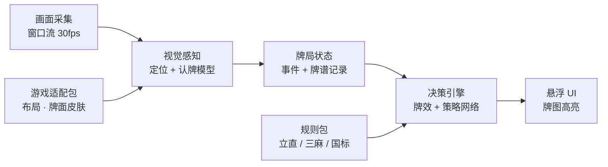

# 麻将 Copilot 设计方案

## 需求

1. 实时监控屏幕上的麻将牌：自己的手牌，以及自己和对手打出过的牌
2. 根据当前牌局给出打牌建议：打哪张，要不要吃、碰、杠
3. 短期适配日本麻将（雀魂、雀姬），长期适配任意三人 / 四人麻将游戏，包括网页版和 Steam 单机版
4. 不操作游戏，只给建议
5. 速度快，在出牌时限内尽早给出建议
6. 界面友好易用
7. 界面实时显示手牌图像和建议（直接标出哪张牌、吃碰杠），而不是用文字
8. 界面实时显示可能胡 / 建议胡的牌型，最多 3 种
9. 开箱即用，不需要繁琐的专业配置
10. 优先离线运行
11. 从每局开局起完整记录对局事件（mjai 格式的牌谱），作为预测的依据；牌谱保存在本机，可用于复盘

运行平台：先做 macOS，P2 加入 Windows。

## 一、核心思路

只读屏幕像素：不读游戏内存，不抓网络包，也不注入游戏进程。

已有的开源日麻助手（如 MahjongCopilot、Akagi）走的是网络中间人路线：要装证书、配代理，而且每款游戏都得单独解析协议。这和"开箱即用"、"适配任何麻将游戏"两条需求冲突。纯视觉方案的代价是要自己做好识别，换来三点好处：游戏无关、零配置、不碰游戏程序。

## 二、总体架构



- 应用基于 Tauri 2。采集、感知、状态、决策四段都在同一个 Rust 进程里运行；界面是网页视图，只接收建议结果，画面本身不经过网页。
- 唯一的例外是识字（局数、分数等文字）：在一个子进程里做。子进程就是 app 自己的可执行文件，加 `--text-helper` 参数启动，不是另一个 bundle，bundle identifier 和签名不变。原因见下文「识字子进程」（#49）。
- 全部在本地运行。
- 游戏适配包和规则包可以替换，接入新游戏只加包，不改核心。

## 三、模块设计

### 1. 画面采集

- 只捕获游戏窗口（Steam 客户端或浏览器窗口都行）：macOS 用 ScreenCaptureKit，Windows（P2）用 Windows.Graphics.Capture。Rust 里按平台各写一个实现，对上层提供同一个接口。我们自己的面板不会被采进去，不会干扰识别。
- 以 30fps 采集，但先做变化检测（各区域缩略图做差分），画面没变就不推理，空闲时几乎不耗电。
- 坐标统一换算成相对窗口的比例，窗口缩放、Retina / 高分屏、全屏切换都不需要用户重新设置。
- 实现（#1）：
  - macOS 用 screencapturekit crate（MIT / Apache-2.0）调用 ScreenCaptureKit，它编译时用 Xcode 自带的 Swift 生成一层桥接代码。Swift 运行库用系统自带的 `/usr/lib/swift`，所以 perception 和 app 的构建脚本都加了这个搜索路径；
  - 实测单窗口采集时，画面静止也每秒送来 30 个完整帧，不会发"空闲帧"，也不附带变化区域。所以采集线程先用 64×36 的亮度小图和上一帧比较（`FrameGate`），没变就直接丢掉，不复制像素；变了才交给流水线。流水线只保留最新一帧（`LatestFrame`），缓冲区重复使用，不按帧分配内存；
  - 窗口的真实像素尺寸 = 内容区域 ÷ 内容缩放 × 屏幕倍率。窗口变大（画面被缩小塞进采集尺寸）或明显变小时，由后台线程改采集尺寸；在此之前先从缓冲区里按内容区域裁出窗口画面；
  - 变化检测（`ChangeDetector`）：每个区域缩成亮度网格，按变化最大的那一格判断，所以牌河里多一张牌也能发现。区域连续 70 ms（约 2 帧）不变才算"稳定"，并且只有和上次报告的内容不同才报告；动画期间不会触发，悬停上浮又落回原样的也不会。

### 2. 视觉感知：传统算法定位 + 现成的认牌模型

不训练识别模型，产品里也不用 VLM。"牌在哪里"用传统算法；"这是哪张牌"交给现成的雀魂认牌模型 pjura/mahjong_soul_vision，赤五按笔画颜色判断，认出的结果在运行时缓存成模板。这个方案来自认牌方案评测（#24，[vlm-eval.md](vlm-eval.md)）：开源小型 VLM 最好也只有约 40%，在线 API 附对照表也只有约 80%，都不采用。

| 层 | 做什么 | 怎么做 |
|---|---|---|
| 画面配准 | 找到游戏画面在窗口里的位置和大小，去掉浏览器边框和留白 | 以手牌为锚点（#3），不用任何游戏截图：先找到手牌，再按牌间距和手牌位置推出 16:9 游戏区域。窗口大小不变时沿用上次的结果 |
| 版面定位 | 知道手牌、四家牌河、副露、宝牌指示、按钮、分数各在哪里 | 手牌直接按牌面检测切出每张牌。牌河和副露平放在 3D 桌面上：用适配包里桌面到屏幕的透视变换，把每家的区域校正成从那一家看过去的正面图，再按牌面切牌，并判断每张牌是竖放还是横放（#8）。宝牌指示在左上角按牌的大小查找。按钮、分数用相对游戏区域的比例坐标 |
| 变化检测 | 找出这次哪些牌位变了 | 按牌位比较前后两帧，只把变化的牌位往下送 |
| 认牌 | 这个牌位上是哪张牌 | 先查运行时模板缓存；没命中，就把这张牌的小图交给认牌模型（34 类）；认出是五时，再按笔画颜色判断是不是赤五，得到 37 个牌名（34 种牌 + 3 张赤五）之一，存进缓存 |
| 数字和按钮 | 局数、自风、本场、余牌数、分数；吃 / 碰 / 杠 / 和 / 立直按钮 | 不用 VLM，也不训练模型。自风看中央框四角哪个风牌是红的（庄家），不认字；局数等文字用系统自带的离线识字（macOS 用 Vision，Windows 在 P2 用 Windows.Media.Ocr），只在那块区域变化时识别一次，结果按缩略图缓存（#9，见下文）。按钮先用颜色检测快速发现；出现了哪些按钮，可以先由状态引擎推出的合法动作缩小范围。按钮一出现，就是"该做鸣牌决定了"最可靠的信号 |

以手牌为锚点的配准（#3）：

- 窗口外框靠不住：浏览器有约 140 像素高的工具栏；超宽窗口两边有留白，部分界面元素贴着画面边缘；竖长窗口里游戏画面上下都留空，手牌不在窗口底部。但换算成 16:9 游戏区域的比例后，手牌的几何关系在 10 张真实截图里几乎不变：牌间距约为游戏区域宽的 0.049，手牌左端约在 0.116 处，手牌上沿约在高度的 0.86 处。
- 找手牌：牌面是浅灰色。从下往上找成片的浅色横带，第一个能切出至少 3 张等间距牌的就是手牌。牌间距用横带亮度的周期（自相关）求出；比牌缝宽的空隙把手牌分成几组（手牌、刚摸的牌、副露），每组张数 = 组宽 ÷ 牌间距，不需要事先知道。手牌总在最左边，所以取最左边够宽的一组：副露多了以后，副露那组会比手牌还长（#40）。每张牌的上沿单独找，所以悬停上浮的牌也不会丢；上浮可达约三分之一张牌，这时从上往下找会停在一横（「一」「伍」）上，所以改从牌面下沿往上找，牌面底部总有一段空白（#40）。
- 推出游戏区域：宽 = 牌间距 ÷ 0.049，左边 = 手牌左端往左 0.116 个宽。牌河、副露、宝牌指示等区域（#8）都按它换算。
- 适配包只存这些比例、牌面颜色阈值和窗口匹配规则，不含任何游戏截图或素材。
- 只在手牌区域有变化时重新检测。同一窗口大小下，第一次可靠找到手牌后锁定牌间距和牌高：之后只接受牌间距在 ±4% 以内的结果，所以手牌被弹窗、变暗等部分遮住时仍能切对；窗口大小变了就重新锁定，同一个新牌间距连续出现三次（游戏自己缩放了）也会重新锁定。检测失败（例如认不出的皮肤）时报告"找不到手牌"；以后再加"用户框选一次"的退路。
- 实测（#3）：10 张真实截图的手牌全部切对；200 张多源模拟截图里，窗口宽度 ≥ 960 像素时 96%（125/130），全部 92.5%；每帧约 2 ms。在实时的雀魂网页版对局上（Chrome，3024×1900 像素），13 张手牌、摸牌、打牌后重新理牌、碰南后剩 11 张都认对；碰出的副露没有混进手牌；没命中缓存时认整手约 440 ms，命中缓存时约 2 ms。锁定牌大小之前，曾有一次手牌被部分遮住时误判成 15 张，锁定后没再出现。

牌河、副露、宝牌指示（#8）：

- 牌桌是固定机位的 3D 画面，牌河和副露的牌都平放在桌面上。桌面是一个平面，所以从桌面到屏幕是一个固定的透视变换（单应矩阵）。适配包只存数字：
  - 这个变换：桌面上 (±6, ±6) 四个点在游戏区域里的位置（`table.corners`）。桌面坐标以牌宽为单位，原点在桌子中心，自家朝 +y；
  - 桌面上的版面：牌河从哪里开始、每行几张、行距（`river`）；副露所在的一条带子（`melds`），同样用自家的坐标写。
  - 这些数字用 `ml/calibrate/table.py` 从录下的画面里拟合：找出四家牌河里的牌，按位置排好行列，一次拟合变换和版面。只用规整的牌河（满行加最后一个短行），立直横放的牌不会把格位带偏。
- 每家的牌河和副露区域先做透视校正，转成从那一家看过去的正面图（对家转 180°，上家、下家各转 90°）。这样牌都是同样大小的竖直矩形。
- 校正后的图里按牌面切牌：
  - 牌面是连成一片的浅色区域；
  - 碰在一起的牌面按宽度平分；
  - 牌面里的亮块（5 筒圈中间那块）和太小的碎片不算；
  - 一行里下一张必须接着上一张，满一行才有下一行，所以牌河旁边的头像、名字不会混进来。
- 横放牌比竖放的宽（约 1.36 个牌宽），也矮 0.36 个牌宽，转正后再认。高度和同一张图里竖放的牌比：牌的浅色侧面可能连进牌面，但竖放、横放连进去的一样高。
  - 牌河里的横放牌是立直宣言牌；
  - 副露里横放牌的位置指明来源：左边来自上家，中间来自对家，右边来自下家；
  - 加杠是两张横放的牌一前一后叠在一起，远的那张是加上去的。
- 副露（第二步）：
  - 每家的副露都平放在桌面上、那一家的右手边，自家的也一样，所以四家共用一条带子（`melds`），和牌河一样校正成正面图。不同家的副露前后位置差了将近一个牌宽，带子留得够宽，不用固定的格位。
  - 从带子右端最右的一张牌面开始往左走，每张接着上一张；接不上、但那个位置有一张牌大小、不是桌面也不是牌面的颜色时，是扣着的牌（暗杠），继续往左。雀魂的牌背是浅绿色、外面一圈浅色边，这圈边会被当成一张牌面；所以找到的「牌面」里大部分是牌背颜色、牌面颜色不到三成时，也算扣着的牌（#77，实战录到的暗杠原来被读成一张扣着、三张牌面，凑不成副露）。比一张牌大得多的（立绘里伸进来的手臂）不算牌面。
  - 横放和这一排里最高的那张比（它是竖放的），不和整张校正图比：带子里还有牌河、手牌背面等别的牌面；透视下带子一端竖放的牌也会和横放的一样宽（#40）。加杠的那张必须紧贴在横放牌上面，离得远的不算。
  - 副露之间没有缝隙，所以按牌本身分组：选一种分法，让每组都是一副副露。三张、其中一张横放，是刻子或顺子；横放的那张上叠着一张，是加杠；四张相同，其中一张横放是明杠，带扣着的牌是暗杠。这样碰 5p 旁边紧挨着一副含 5p 的顺子，也不会被认成杠。
  - 副露按做出的先后排（从右到左），每副从左到右；来自哪一家、是什么副露，留给状态引擎判断。
- 宝牌指示（第二步）：左上角 5 格的框是界面元素，不在 3D 桌面上。超宽窗口里它可能贴着窗口边，而不是贴着游戏区域，所以不用固定坐标：
  - 在左上角找大小合适（相对手牌牌距 0.545 × 0.807）、纯灰色的牌面，最左边的就是第一张指示牌；
  - 往右每隔 0.594 个手牌牌距是下一格，是纯灰色的牌面就算翻开了，直到第一张牌背为止；
  - 牌背的颜色随皮肤变化（见过橙色和绿色），所以按"不是纯灰色的牌面"来判断；
  - 宝牌指示单独用一份模板缓存。
- 认牌走同一个识别器（模板缓存 → 认牌模型 → 赤五规则）。缓存按区域分开：手牌、各家牌河、副露、宝牌各一份。
- 变化检测从只盯手牌，改成盯手牌、四家牌河、四家副露和宝牌框；哪块稳定了就只重读哪块。
- 读出的结果先过一遍检查，不通过就保留上一份结果，并标上"?"：
  - 每种牌最多 4 张；
  - 牌河只增不减，被鸣走的牌除外；
  - 宝牌指示只增不减。
- 下家、对家的牌面比自家暗（最亮的灰色约 180，自家约 225），整个桌面有时也会变暗，游戏还把一部分打出的牌画暗（约 169，旁边的约 218），所以"浅色"的标准跟着每张校正图里最亮的灰色走：比它暗 60 以内都算，最低到 130（#40，原来是 25，画暗的牌会截断牌河）。
- 游戏会把和鼠标下同种的牌染成粉色（红最高、绿蓝接近，离散度多放宽 15）或浅蓝色（蓝 ≥ 绿 ≥ 红，多放宽 25），手牌和桌上都算牌面。能鸣的那张牌周围的绿色光圈不算：它是绿色最高，以前会被当成一张白板。
- 风险：认牌模型主要见过手牌。牌河里的牌更小，对家的牌离镜头最远：3024 像素宽的窗口里约 65 像素宽，1280 宽时只有约 28 像素，会被标"不确定"。按家分别量准确率。
- 实测（第一步，牌河）：
  - 标定：76 张录下的帧（3024×1900）里 1578 张规整牌河里的牌，拟合误差中位数 4–8 像素，p90 约 15 像素（牌宽约 65–90 像素）。同一组数字也能把另一个客户端 1493×912 的截图校正对。
  - 读牌（`perception/examples/eval_table.rs`）：3 局 74 帧，2,332 次读牌，错 1 次，不确定 6 次，横放判断全对，四家牌河全对的帧 73/74（98.6%）。每局只标最后一帧，之前每帧按前缀核对；另外检查了牌河长度只在被鸣牌时减少。
  - 唯一的错：刚打出的 3p 上扫过一道白色反光，认成 4p。它已被标为"不确定"，没有进缓存，下一帧就认对了。
  - 评测中发现并修好两个问题：5 筒圈中间的亮块被当成一张牌，截断了后面的牌河；下家、对家的牌面太暗，固定阈值余量不够。两个都补了复现测试。
  - 耗时：四家校正加切牌约 15 ms，还没优化，接进流水线时只重读有变化的那家；认牌大多命中缓存，冷启动时 p95 约 280 ms。
  - 观察到：雀魂把一部分打出的牌画得暗一些，可能是摸切标记（待确认），那样以后能读出他家的摸切 / 手切；有的牌上会有一道白色反光。
- 实测（第二步，副露和宝牌）：同样 3 局 74 帧，每局只标最后一帧。
  - 副露：352 次读牌全对，3 次不确定（带白色反光的东）；分组和横放全对。录到的有自家的吃、碰和明杠（横放的是赤 5p），上家两副碰（含赤 5m），对家三副碰。
  - 宝牌指示：79 次读牌全对，开杠后多翻的一张也读到了。
  - 每局里副露数和宝牌数只增不减；四家牌河、副露、宝牌全对的帧 73/74，唯一的错还是牌河里那张反光的 3p。
  - 另一个客户端 1493×912 的截图（橙色牌背）上，宝牌和上家的吃也读对了；1280×720 时对家的副露只有约 25 像素宽，全被标"不确定"。
  - 2026-10-27 录到了自家的暗杠（#77）；加杠和下家的副露还没录到，只有合成图测试；一局结束时的结算画面会被当成手牌，要在第三步跳过。
- 接进流水线（第三步）：
  - 找到手牌以后，监视线程同时盯手牌那几行和它上方的整个桌面；哪块稳定了，就把手牌和牌桌一起读一遍（`perception::snapshot`），有变化才发新的建议，所以别家打牌以后进张也会更新。
  - 快照检查：手牌加牌桌上某种牌超过 4 张，或同一花色两张赤五，就不信这次读到的牌桌，沿用上一次对得上的。读错的牌、结算画面、角色立绘一般都会让它对不上。
  - 手牌最多 14 张：读出更多的不算手牌，也不会被锁定；已锁定的牌距如果把手牌切出超过 14 张，说明锁错了（第一次实测时，启动时锁到了大厅里一排小牌的大小，之后每手都被切成 42 张），丢掉重新找。
  - 出建议时，牌桌上看得见的牌都算"已见"，每种和手牌合计封顶 4 张，读错一张也不会让建议算不出来；界面显示宝牌指示和已见张数。
- 分三步做：
  1. 截图和录制工具、桌面透视标定、四家牌河；
  2. 四家副露、宝牌指示；
  3. 接进流水线："已见牌"算进进张，界面显示宝牌指示，重测延迟。

局数和自风（#9 第一步）：

- 中央框是一个立在桌面上的盒子，位置跟着桌面透视变换走，适配包（`centre`）只存它几个部分投到桌面上的坐标：四个风牌的中心（按自家、下家、对家、上家的顺序）和局数标签「東1局」的范围。因为盒子高出桌面，它们不能按家转着算，四个角各记一个坐标。
- 自风不认字：四个角的风牌里，庄家的是红底的「東」。四个角里恰好一个红色占比 ≥ 15%、其他都 < 5% 时，红的那家就是庄家，四家的风按出牌顺序推出（庄家东，下一家南……）。结算画面、和牌特效挡住风牌时读不到，就当作没读到，不会读错。
- 局数用系统的离线识字：把标签校正成从自家看过去的正面图，按每个牌宽 96 像素采样（约 170×90 像素，和窗口大小无关），交给 Vision（`zh-Hant`、`ja-JP`，精确模式，不做语言纠正），在识别出的文字里找「风字 + 1–4」。只在看得到庄家风牌时才读标签，所以结算画面不花识字的时间。
- 识字结果按标签的 48×24 灰度缩略图缓存：标签一局只变一次，同一个样子只识别一次，之后按像素比对（8×4 格里最大的平均差 ≤ 12）。窗口大小变化时清空。这只是缓存，不是训练，也不写盘。
- 识字完全在本机运行，不联网，不用下载模型。进程里第一次调用要加载系统模型（约 150 ms；系统更新后第一次可能要十几秒），所以监视线程启动时在后台先跑一次。
- 识字子进程（#49）：在 macOS 27 上，Vision 可能在运行几分钟到几小时后开始每次都报 `CRImageReaderError error 1`，同一进程里不会再好（`.fast` 级别还能用，但读不了中日文），换一个新进程就正常；其他 app 也遇到了同样的问题。所以 app 把识字放在子进程里：
  - 通过子进程的标准输入输出通信：发过去宽、高和 RGB 像素，收回识别出的几行文字（JSON）。只走本机管道，不落盘，不联网。标签图只有几百像素见方，往返的开销可以忽略。
  - 子进程识别失败（或者退出了）时，结束它，启动一个新的，用新进程把这张图再读一次。
  - 新进程也失败时，先不再识字，30 秒后再换新进程重试；这期间面板显示「文字识别失效，读不到局数和分数，请重启」，状态引擎就不再只显示「画面被挡住」。
  - 日志只在开始失败时和每次重试失败时各记一条警告（带失败次数），恢复后记一条，不再每次识别都记。
  - 子进程在 app 关闭标准输入（退出或替换它）时退出。评测用的 example 仍在自己的进程里直接调用 Vision。
- 实测（`perception/examples/eval_table.rs`，211 张录下的帧，3024×1900，两场半庄里的東1局、東2局，含连庄和流局；每段帧按画面逐张核对后标注）：
  - 庄家（自风）：206/211 对，0 错；没读到的 5 帧都在一局结束时：手牌倒下后找不到或找错了手牌（4 帧，桌面位置跟着偏了），「和」的特效挡住了下家的风牌（1 帧）。
  - 局数：207/211 对，0 错，没读到的是同样的帧。不用缓存、每帧单独识字是 203/205 对，错的 2 张也是手牌倒下的那两帧。
  - 缓存：同一局的标签和之前最近的一张，中位数差 1.0，p95 8.6；東1 和東2 的标签最少差 21.1。211 帧里只识字了 9 次。
  - 耗时（M4 Pro，release）：看风牌颜色约 0.01 ms；读局数命中缓存时约 0.14 ms，没命中（每局一次）时识字 p95 约 28 ms，不影响 300 ms 的预算。
  - 不足：录到的只有東1局和東2局，南场、西场和 3、4 局没有真实样本，只有解析的单元测试。
本场、供托、余牌数和四家分数（#9 第二步，`perception::numbers`）：

- 位置：
  - 四家分数在中央框四边，各自朝向那一家，所以按那一家的坐标校正成正面图再识别，`centre.scores` 给出四个框；
  - 余牌数在局数下面，只取数字，不含"余"字（`centre.tiles_left`）。连"余"字一起识别时，大约九次里有一次整串认错；
  - 供托（立直棒）和本场数在宝牌指示框下面，写作"x 1"，按第一张宝牌指示牌的位置找（`dora.sticks`、`dora.honba`，单位是手牌牌距）。
- 都用系统的离线识字，但尽量少识字：
  - 分数和余牌数逐个数字记：把数字切成一个个字形（按数字本身的颜色找，分数是橙色、余牌数是青色），每个字形记下它是几，从整串识字的结果里学来，之后按像素比对。字形按各自的墨迹裁切，所以位置差一两个像素、旁边轮到谁的光条，都不会让它认不出；
  - 供托和本场的小框很少变，整张缩略图缓存。
- 检查：四麻里四家分数加上桌上供托每根 1000 点，总是 100000。对不上（比如特效挡住一位数字）就不采用这次的分数。
- 只在看得到庄家风牌时读，结算画面不花识字的时间。
- 实测（`eval_table.rs`，同样 211 帧，其中 202 帧看得到中央框）：
  - 202 帧四个数都读到了，分数全部对得上 100000，同一个分数下余牌数从没变多过；和每帧整串识字的结果逐帧一样；
  - 第一版按整张缩略图缓存分数，因为光条和一两个像素的偏移，202 帧要识字 166 次，每帧 p95 92 ms；改成逐个字形以后只识字 25 次，每帧中位数 2.9 ms、p95 20 ms。
- 界面显示局数、自风、余牌数、本场和供托；开发版的牌桌列表里显示四家分数。
动作按钮（#9 第三步，`perception::buttons`）：

- 能做动作时，画面下方出现一排按钮，最右边总是灰色的「跳过」，其他按钮从它左边一格一格往左排，每格一个。每种按钮颜色不同：吃绿、碰青、杠紫红、和红、立直橙、自摸深红。
- 所以不认字，只看颜色：
  - 跳过按钮的框里约一半是灰色，才算按钮出来了。角色立绘、和牌特效、结算画面也会在那一带出现颜色，但都没有跳过按钮；
  - 再从紧挨着跳过的那一格往左，每格取中间一段（避开斜边），彩色像素占 30% 以上算有按钮，按它们色相的中位数认是哪一种（差 15° 以内），碰到空格就停。桌布是蓝色，和碰的青色只差约 17°，所以桌布的色相（212–250°）不算彩色；
  - 位置用相对游戏区域的比例，颜色用色相，都写在适配包里（`buttons`），不存任何按钮图片。因为不认字，中日英哪种按钮文字都一样。
- 按钮一出现或消失，牌桌那块区域就有变化，监视线程会重读并发出新结果；界面在局数那一行显示"可以 碰 杠"。牌桌和手牌对不上而沿用上一次的牌桌时，按钮仍用这一帧读到的。
- 实测（`perception/examples/eval_buttons.rs`，1557 张录下的帧，3024×1900，逐张对过画面）：
  - 94 张有按钮，全部认对：吃 47、碰 19、杠 7、和 4、立直 7、自摸 1，还有两个按钮同时出现的吃 + 和 7 张、碰 + 杠 2 张；其余 1463 张（含立绘、和牌特效、结算画面）一个按钮都没读出来；
  - 跳过框里的灰色比例：有按钮时约 0.5，没有时都在 0.1 以下；有按钮的格子彩色比例 ≥ 0.5，空格接近 0；同一种按钮的色相在各帧之间只差约 1°，不同种至少差 46°；
  - 耗时：中位数 0.01 ms，p95 0.07 ms。
  - 评测中发现：悬停时最右边那张手牌抬得很高，手牌右端被定在这张牌中间，切不出整数张，锁定牌距后就去找了牌河那一行。现在手牌两端也试一下这一组浅色本身的边，取最合牌距的那种，补了复现测试。
  - 还没录到：吃 + 碰、三个按钮同时出现、立直和自摸 / 杠同时出现、九种九牌；自摸只有 1 张。第三格的位置是按前两格的间距推出来的，还没有实测。

运行时模板缓存：

- 同一款游戏、同一套牌面、同一个窗口大小下，同一种牌的画面几乎一模一样。认牌模型认出一张牌后，就把这张小图存成模板；同一种牌以后再出现，直接按像素比对，几毫秒就够，不再调用模型。
- 一局下来 37 种牌很快都会有模板，之后几乎都走这条快速路径。这只是缓存，不算训练。
- 缓存按"游戏 + 牌面 + 窗口大小 + 区域种类（手牌、牌河……）"分组；比对分数不够高时，退回认牌模型重新认。
- 比对方式（#4）：把牌图缩成 24×32 的小图，按每个通道的平均像素差比较，允许上下错开约五分之一张牌（悬停上浮）、左右错开一个像素。差值不超过 12，而且比其他任何牌的模板都至少近 8，才算命中。阈值用 10 张真实截图标定：同一种牌的差值中位数 2.8，不同的牌从没低于 13.1。
- 赤五和普通五只差几笔的颜色，小图分不开，所以缓存命中五时，是不是赤五按这张牌自己的笔画颜色重新判断，不沿用模板的（#40）。
- 实测（#4）：真实截图上，整手 14 张都命中缓存时只要 0.5 ms；上浮 14% 的牌 132 张里 130 张命中，另外 2 张退回认牌模型，全部认对，没有一次命中出错。多源模拟中，缓存和认牌模型不一致的 7 次都是缓存对（模糊的牌命中了之前清楚时存下的模板）；唯一一次命中出错，是认牌模型以 0.95 的置信度认错后存下的模板，模型自己同样会认错。
- 开局（`start_kyoku`）时做一次完整识别：手牌、宝牌、局数和点数。这时离第一次打牌还有几秒，时间够用。

"不确定"标记（#4）：

- 牌宽不到 28 像素，或认牌模型的置信度低于 0.7 时，标为"不确定"：界面照常显示最可能的结果，加"?"角标；这张牌不存进缓存。牌太小时，界面还要提示用户把窗口调大。
- 两个阈值在评测数据上选定：多源模拟里，认牌模型的 76 次认错标出了 71 次，真实截图的 132 张牌一张也没有被误标。阈值是在评测数据上选的，还要用新截图验证。

认牌模型和赤五规则：

- 模型：[pjura/mahjong_soul_vision](https://huggingface.co/pjura/mahjong_soul_vision)，ViT-base 图像分类器（Apache-2.0），由原作者用 [pjura/mahjong_souls_tiles](https://huggingface.co/datasets/pjura/mahjong_souls_tiles) 训练，不是我们训练的。它只认 34 种牌，没有赤五类别。注意：数据集说明页链接的 pjura/mahjong_vision 是一个决定打哪张牌的小网络，不是认牌模型。
- 赤五规则：普通的五都有非红色的笔画（5 万的黑色"伍"、5 筒的黑色圈、5 索的绿竹子），赤五只有红色。只看牌面中间部分，非红色笔画占全部笔画的比例低于 0.25 就判为赤五。牌图太小（宽度不到 28 像素）时整张牌都标为"不确定"。
- 评测结果：在 10 张来源独立的真实截图（132 张手牌，含 4 张赤五）上全部正确；在 2640 张多源模拟手牌上 97.1%，窗口宽度 ≥ 960 像素时 100%。132 张全对时，95% 置信区间的下限是 97.2%；要证明 ≥ 99.5%，还需要约 600 张来源独立的真实牌。
- 使用条件：游戏窗口宽度至少约 960 像素。更小时索子之间、5 和 9 之间开始混淆，界面提示用户把窗口调大。
- 运行（#4 实测）：PyTorch 权重转成 ONNX，在 Rust 里用 ONNX Runtime 在 CPU 上推理。预处理（Pillow 的双线性缩放）和赤五规则都按原算法逐步移植，在 2989 张牌上和 PyTorch 的结果完全一致。
  - 单张约 33 ms，整手 14 张约 350 ms，加载约 0.1 秒，内存约 0.9GB；
  - 不用 CoreML：它不接受可变的批大小；固定批大小时，首次加载要编译 70–110 秒，整手也只快一倍；
  - 用 fp32：它和 PyTorch 的结果完全一致，评测结论可以直接沿用。int8 量化版只有 88MB、稍快一点，真实截图上同样全对，但在数据集测试部分多错一张；等真实截图扩充到约 600 张牌后再比较，不多错再换。
- 下载（#4 定下）：原作者的仓库只有 PyTorch 权重，app 读不了；作者从 2023 年起没再更新，等不到他发布 ONNX。所以由我们把转换后的 ONNX 文件放在自己的 Hugging Face 模型仓库 [xzhe121/mahjong_soul_vision-onnx](https://huggingface.co/xzhe121/mahjong_soul_vision-onnx)，app 首次启动时按固定版本下载并校验哈希：修订版 `d1da028b53b97e309e67ddfed6e4b61e85603f65`，`model.onnx` 344,641,310 字节，SHA-256 `07fd9d39409ff453d6ad06bc83be3f74aa359b24365f5cd70c839237c0fab239`。
  - 仓库里只放这一个模型文件和原有的配置文件，附原始许可（Apache-2.0）和说明（来源、改动：只转换格式，权重不变；训练数据是原作者用雀魂截图做的）；不放任何截图或数据集；
  - 它是用游戏截图训练的，有版权灰色地带，托管的风险由我们承担。收到下架要求就撤下；
  - 退路：撤下后，改为让 app 从原作者仓库下载原版 PyTorch 权重，在本机读出权重交给我们自带的计算图（只有网络结构，不含训练得到的东西）。
  - 导出不是逐字节可复现的，重新导出的文件哈希会变，所以 app 锁定的是上传的那一份。
- 退路：遇到分类器认不准的皮肤或游戏，让分类器先猜出 37 张模板，由用户在界面上确认或改正一遍，之后全走模板比对。这样仍然不需要训练。

鲁棒性处理：

- 稳定帧门控：各区域连续 2–3 帧一致才认定结果。摸牌飞行动画、鸣牌特效、雀魂的角色立绘这类帧直接跳过。
- 鼠标悬停时手牌会上浮，按牌位切图时要容忍几个像素的位移。
- 宝牌有闪光动画（cvmaj 的经验）：模板比对要能容忍闪光，或者避开闪光帧取样。
- 认牌模型也会认错：用分类置信度和快照规则交叉检查，比如每种牌最多 4 张、雀魂四麻每种花色只有一张赤五（同时认出两张赤五筒，说明至少一张错了）。拿不准时在界面上显示"?"角标。

评测集：

- 用游戏里的牌谱回放录屏。牌谱本身就是标准答案，能自动得到大量带答案的画面，用来测识别准确率和事件推断是否正确，不用于训练。
- 整桌评测（#8）：开发版 app 的调试行有"截图"按钮和"连续录制"开关，正式版里没有。开发版只在本机构建，不放到 GitHub 上（2026-10-26 定）。有两种：`npm run tauri dev` 跑起来的，和本机打包的「Mahjong Copilot Dev」（`dev-tools` 功能，bundle id `io.github.jason1yuan.mahjongcopilot.dev`，能和正式版同时安装，单独授权屏幕录制、单独下载模型）。
  - 截图存下当前这一帧；连续录制在每次手牌变化时存一帧，也就是每巡摸牌、打牌各一次；
  - 都存成 PNG，不进 git：`tauri dev` 存在仓库的 `recordings/live/`；打包开发版没有仓库，存在它自己的 app 数据目录的 `recordings/live/`。这是 CLAUDE.md 允许的"明确开启的调试录制"：只有用户手动操作才会存；
  - 存图在单独的线程上做，不占识别和建议的时间。
  - 手牌和自家副露数对不上时监视线程会丢掉这一帧、等画面稳定（#39）。副露认错时会一直对不上，从外面看就是卡住了：所以每次都以 info 写进日志（几张手牌、几副副露、连续几帧），连续 3 帧以上时连续录制每 5 秒也存一帧（文件名带 `stuck`），留下调试用的画面（#77）。
- 整桌标注：每局只标最后一帧，那时四家牌河、副露和宝牌都最全；之前每一帧的答案就是它的前缀，被鸣走的牌除外。先用识别结果预标，再逐张看图核对，用户抽查。
- 截图、录屏，以及 pjura/mahjong_souls_tiles 这类外部数据集，都只在本机用于评测，不提交到仓库，也不随 app 分发。这些图片都是雀魂的游戏美术，数据集上标的 Apache-2.0 不能真正授权游戏美术本身。

### 3. 牌局状态引擎：从画面到 mjai 事件

画面只能给出一帧帧的局面，而 Mortal（通过 libriichi）只接受 mjai 事件序列。抓网络数据的工具（如 Akagi）能直接拿到事件；我们要自己从画面推出来。状态引擎就负责这一步：

```
逐帧识别（每张牌带置信度）→ 等画面稳定 → 局面快照
  → 事件推断（比较前后两张快照）→ mjai 事件
  → libriichi 维护牌局状态（同时检查事件是否合法）→ Mortal 和规则层
```

局面快照包括：自家手牌和刚摸的牌、四家牌河（打牌顺序和横放标记）、四家副露（每组来自哪家）、宝牌指示、场风 / 局数 / 本场 / 供托、各家点数和立直棒、当前出现的动作按钮。

从开局起完整记录牌谱（需求第 11 条）：

- 牌谱是预测的依据。助手要在对局开始前打开，从开局起记录每一个事件；对局结束后，把整场的 mjai 牌谱保存到本机的应用数据目录，可用于复盘。牌谱只存在本机，不上传。
- 对局进行中才打开助手时，界面提示"建议在对局开始前打开"，并走下面"中途打开"的后备流程。

每种 mjai 事件在画面上的依据：

| mjai 事件 | 画面上的依据 | 难度 |
|---|---|---|
| 新一局开始（`start_kyoku`） | 局数显示、分数盘、宝牌区、配牌 | 容易 |
| 自家摸牌（`tsumo`） | 手牌右侧多出一张单独放着的牌 | 容易 |
| 他家摸牌（`tsumo`） | 画面上看不到；mjai 本来就用 `?` 表示，在他家打牌前补一条 | 容易 |
| 打牌（`dahai`） | 某家牌河末尾多出一张，牌河顺序就是打牌顺序 | 容易 |
| 摸切 / 手切（`dahai` 的 `tsumogiri` 字段） | 自家一定知道；他家要追踪打出的牌是从手牌最右端还是中间出去的动画 | 难 |
| 吃、碰、明杠（`chi` / `pon` / `daiminkan`） | 某家副露区多出一组牌，横放的那张指明来源；来源家牌河末尾那张同时消失 | 中等 |
| 暗杠、加杠（`ankan` / `kakan`） | 副露区的变化，暗杠有两张牌背朝上 | 中等 |
| 翻新宝牌（`dora`） | 宝牌区多出一张指示牌 | 容易 |
| 立直（`reach` / `reach_accepted`） | 牌河出现横放的牌，加上立直棒 | 容易 |
| 和牌、流局、一局结束（`hora` / `ryukyoku` / `end_kyoku`） | 下一局开始时的分数和供托：谁赚谁赔就知道谁和了谁，只有听牌费是流局（#10，不读结算画面） | 中等 |

推断规则：

- 按行动顺序排序：两帧之间可能发生好几件事（动画很快、漏帧、有人鸣牌），用逆时针的行动顺序和牌河里的顺序把它们排好。有人鸣牌时，中间的玩家会被跳过。
- 只在画面稳定后才生成事件：摸牌和打牌的动画、鸣牌特效、角色立绘遮挡牌桌时都不推。
- 自我校验和重新同步：每一帧都拿"由事件推出的局面"和"画面上的快照"对照，不一致（比如之前认错一张牌）就按当前快照重建历史，不让错误累积。漏帧导致某个事件推不出来时，同样按快照重新同步，并在牌谱里标出这个缺口。libriichi 收到不合法的事件会直接报错，作为第二道检查。快照本身还要满足这些规则：
  - 每种牌最多 4 张；
  - 手牌张数 = 13 − 3 × 副露数（摸牌时再 +1）；
  - 牌河只增不减（被鸣走的牌除外）；
  - 宝牌指示只在杠之后增加。
- 中途打开程序（后备）：从当前快照补出一段合理的历史，按牌河顺序和行动顺序交替生成各家的打牌事件，副露按位置插进去，并在牌谱里把这一段标成"补出的"。这时 Mortal 的建议可能偏弱，界面上会提示。具体做法见下面的"第二步"。
- 他家的摸切 / 手切：Mortal 的输入编码用到了这项信息，包括每家最近一张手切的牌，但从画面上很难判断。先统一当作手切处理。#22 在 40 局模拟对局上实测：和知道真实摸切信息时相比，Mortal 在 97.4% 的决策（打牌决策 97.2%）里选得一样，影响不大；以后可以通过追踪动画帧来判断。
- 拿不准的牌：在 UI 上加一个"?"角标，先按最可能的结果计算，用户点一下就能改。

实现（#10 第一步，`mahjong_core::game`，暂时只在 core 里，还没接画面）：

- 引入 libriichi 的 `mjai`（事件）和 `state`（`PlayerState`，从一家的视角维护牌局状态，事件不合法时报错，以后也是 Mortal 的输入来源），去掉 Python 绑定；Mortal 的输入编码 `obs_repr` 等 #22 再引入。改动记在 `third_party/libriichi/README.md`。
- 引擎的输入是 `Scene`：自家手牌和单独放着的摸牌、四家牌河（含横放）、四家副露（按屏幕上的摆法：横放的位置指明来源，加杠叠在上面，暗杠两头扣着）、宝牌指示、局数、庄家、本场、供托、余牌数、分数，座位都相对自家。perception 的快照在第三步转成它，core 不依赖 perception。
- 推断：引擎自己按已有事件维护一份"由事件推出的局面"。每来一张新快照，就按行动顺序找一串事件把这份局面变成快照（深度优先，可能性大的先试）：
  - 每一步是一组事件：摸牌；打牌（横放就是立直：`reach`、`dahai`、`reach_accepted`）；鸣上一张打出的牌（吃只能鸣上家的，鸣了以后跳过中间的人）；暗杠、加杠。他家摸牌记为 `?`，他家的摸切 / 手切记为手切；
  - 自家摸到什么，按手牌、牌河和副露算出来；两次快照之间摸了几张，看余牌数（每摸一张少 1）。被鸣走的牌在牌河里不留痕迹，没有余牌数时，鸣牌可能被提早一巡、少算一次摸牌；
  - 供托（立直棒）数也要对上：立直宣言牌被鸣走时，牌河里没有横放的宣言牌，只有多出来的一根立直棒说明有人立直了；
  - 杠宝牌：暗杠马上翻，明杠、加杠在下一次打牌后翻；
  - 两张快照之间最多推 40 组事件（约四五巡）；新打出的牌和摸牌数加起来已经超过 40 组时不搜，直接算解释不了。
- 每个事件都喂给 `PlayerState`。找不到解释时，多半是之前认错了一张牌：拿快照里的牌替换之前牌河里同一位置的牌，或者替换自家摸到 / 起手的牌，重放这一局再试，成功就改写这一局的事件（`rewritten`）。还不行就不接受这张快照，等后面的快照。
- 快照先过基本规则：每种牌最多 4 张、每种花色最多一张赤五、手牌张数 = 13 − 3 × 副露数（轮到自家时 +1）；牌河、副露、宝牌只增不减（被鸣走的除外）在推断时检查。
- 一局从"牌河和副露都空、局数或本场变了"的快照开始：`start_kyoku` 的自家起手是快照里的 13 张，他家是 `?`，自家的座位号由局数和庄家位置推出。
- 测试数据来自 core 测试里自带的模拟器（不用外部牌谱）：固定种子洗牌，四个简单的机器人按牌效打牌，会吃、碰、三种杠、立直，立直后才和（保证有役），牌摸完就流局。它从一家的视角记下屏幕会显示的快照和这一家应看到的 mjai 牌谱；牌谱都能被 libriichi 完整回放。
- 实测（模拟器，每个 4 局）：
  - 每张快照都给（40 场）：推出的事件和牌谱完全一致（他家的摸切 / 手切和一局结束的事件除外，后者第二步做），没有一次需要改写；
  - 漏掉一部分快照（几个人在两张快照之间都行动了）：留 90% 和 75% 时 100 场全部完全一致，留 60% 时 93 场，留 50% 时 75 场；不一致的都是画面本身分不出来的情况：好几巡没有快照时，同一家打了两张牌、其中一张被鸣走（顺序分不出），或自家先后摸进两张都没打出（顺序分不出）。每张快照都能解释，事件都合法。测试里各跑 40 场：留 75% 时要求全部一致，留 60% 时至少 36 场；
  - 一张快照里故意认错一张牌：之后的快照会发现并改正，最后的事件和牌谱一致；
  - 耗时（release）：每张快照中位数 0.003 ms，最多约 1.2 ms；中途打开时补出历史中位数 0.08 ms，最多约 1.1 ms。
- 第二步（一局结束、整场牌谱、中途打开）：
  - 一局怎么结束不读结算画面，看分数：下一局开始时，拿它的分数和供托跟这一局最后读到的（加起来正好 100000 才算数）比（`mahjong_core::game::ending`）。只有一家赔、一两家赚是荣和（两家是一炮双响，按行动顺序排），三家赔一家赚是自摸，赚的里面包括桌上的供托；只有听牌费（+3000 / −1000 × 3、±1500、+1000 × 3 / −3000）或分数不变、供托留着，是流局。生成 `hora`（带分数变化）或 `ryukyoku`，再加 `end_kyoku`。庄家 1000 点 all 的自摸、又没有本场和供托时，分数和"只有庄家听牌的流局"一样，当作流局；整场最后一局没有下一局可比，结束方式记为未知；
  - 整场牌谱：第一局之前写 `start_game`；再看到東1局 0本場、四家都是 25000 时，前一场写 `end_game`，新一场开始；离开牌桌时由 app 调用 `end_game`。`log_lines` 给出 mjai JSON Lines，`marks` 给出哪些段是补出来的（`filled`）、哪里是缺口（`gap`）、哪局的结束方式未知（`unknown_ending`）。写成文件放进应用数据目录在第三步接流水线时做；
  - 中途打开（或一局开头没看到）：从当前快照补出历史。自家起手 13 张取现在还在手里和副露里的牌，不够再用最早打出的牌，其余都是之后摸到的；然后找一串从开局到这张快照的事件（同样按行动顺序，余牌数要对上），libriichi 接受。这一段标成 `filled`；
  - 漏得太多：一局里连续 3 张快照都解释不了时，按最新的快照把这一局重新补出来，标成 `gap`；
  - 搜索时记住已经到过的局面（各家牌河和副露走到哪、轮到谁、手牌、余牌数、供托等），同一个局面不再搜第二遍，补出整局历史也很快；
  - 补出历史时，开局的供托 = 快照里的供托 − 牌河里有横放牌的家数。如果有人的立直宣言牌刚被鸣走、还没打下一张，这根棒会被当成之前留下的；等他下一张横放的牌出来，解释不了，连续 3 张后按新快照重新补出这一局（标成 `gap`），之后就对了；
  - 实测（模拟器）：每张快照都给时，一局的结束方式（荣和、自摸、一炮双响、流局的听牌费）都推对；连续两场时前一场写 `end_game`、后一场 `start_game`；从一局中间任意一张快照开始，补出的历史 libriichi 都接受，之后的事件和牌谱完全一致；中间漏掉半局时，补完后的事件和牌谱完全一致。
- 第三步（接进实时流水线）：
  - perception 的快照转成引擎的 `Scene`（`Snapshot::scene`）；监视线程每次发出手牌，app 先发建议，再把快照交给引擎，所以引擎不占建议的延迟；
  - 画面被挡住时不当成"跟丢了"：中央框不在（角色立绘、和牌特效）、某家牌河或副露比已知的短（最新打出的那张没读到、被挡住）、自家手牌少一张而牌河副露都没变（打出的牌还在飞），这些快照都标成 `covered`，不计入"连续 3 张解释不了"；
  - 余牌数和供托会比牌慢一点更新：立直后的那一刻供托还没加上也算对；余牌数对不上时，再试差一张的两种；
  - 一局开始要局数往前走（场风、局、本场依次比较），或者又是一场的東1局 0本場；读错一下局数不会把这一局结束掉。新的一局先建好，成功了才结束旧的一局；
  - 牌谱存到应用数据目录的 `game-logs/`：每场一个 `<开始时间>.mjson`（mjai JSON Lines），旁边一个 `.marks.json`（哪些段是补出的、哪里是缺口、哪局结束方式未知）。每开始一局、每开始一场、监视停止时写一次，写文件放在另一个线程上；
  - 界面在局数那一行下面显示"牌谱 东2局 1本场 · 312 个事件"；这一局是中途开始看的时提示"建议在对局开始前打开"，有补过的段落时显示几段；开发版还显示最后一帧是跟上了、被挡住还是对不上。
- 实测（`perception/examples/eval_engine.rs`，录下的 2,700 多帧按时间顺序喂给引擎，相隔 10 分钟以上的算不同场次；录屏只在手牌变化时存帧，比 app 实际看到的稀）：
  - 2,101 张快照跟上了，396 张画面被挡住，121 张解释不了（其中多是左家牌河里个别牌认错，例如 2m / 8m）；另有 141 张手牌和副露数对不上，app 里监视线程已经先丢掉了（#39）；
  - 8 个场次里，一局怎么结束都推出来了，只有每场最后一局（之后没有下一局可比）不知道；从头录到尾的一场推出了 9 局的结束方式（荣和、自摸），和画面上的分数变化对得上；
  - 存下来的 8 份牌谱都能被 libriichi 从头到尾回放，没有一个事件被拒绝；
  - 引擎每张快照中位数 0.013 ms，p95 0.034 ms；最慢的约 250 ms，是跟丢后按画面重新补出整局，发生在建议发出之后。
  - 还没做到的：左家牌河的认牌错误会让个别快照对不上，要在认牌那边改进；他家摸切 / 手切仍统一记为手切。

### 4. 决策引擎（两层叠加）

规则和搜索层：结果确定、可以解释，所有麻将规则都能用，是兜底。日麻的向听、和牌判定、番符和点数直接复用 Mortal 的 libriichi（放在 `third_party/libriichi`），它还带有单人期望值计算（每种打法的听牌率、和牌率和期望得点），以后做打牌排序和目标牌型时可以用上。

- 向听数（查表法，微秒级）
- 有效进张，扣掉场上已经看得见的牌
- 役和番符计算、打点估算
- 用蒙特卡洛估算和牌概率
- 防守：现物、筋、壁、one-chance、每张牌的危险度
- 推还是退：比较期望得点和放铳损失
- 吃、碰、杠的判断，就是对比"鸣"和"不鸣"两个分支各自的速度 × 打点 × 安全度

神经策略网络（日麻的主力）：采用 Mortal，不自己训练。输入牌局状态，输出每个可选动作的评分，单次推理在 10ms 以内。

- 模型：Mortal v4 结构（192×40，约 1083 万参数）。Mortal 作者本人不发布权重，所以权重用 Hugging Face 上的 haor/Mortal-S42（Apache-2.0，43.7 MB）。调研的候选里它许可最清楚，强度和社区里最强的 Mortal 权重基本持平。
- 输入编码：直接复用 Mortal 的 libriichi（Rust），从 mjai 事件生成 1012×34 的观测和 46 维的合法动作掩码，和原实现一致由构造保证。libriichi 是 AGPL-3.0，所以整个项目以 AGPL-3.0 开源，我们接受这一点。
- 推理：转成 ONNX，在 Rust 里用 ONNX Runtime 推理，并用对照测试保证和原 PyTorch 模型的输出一致。实测同结构的模型在 CPU 上约 7ms，走 CoreML 反而要 21ms，所以决策模型用 CPU。
- 范围：只支持四麻，三麻先只靠规则层。

实现（#22，`mahjong_core::mortal`）：

- 转换：`ml/convert/export_mortal.py` 按 `ml/vlm_eval/config.toml` 里 `[mortal]` 固定的修订版和 SHA-256 下载权重和 Mortal 的 `model.py`，把编码器和 Q 值头合成一张图导出：输入 `obs`（batch×1012×34）和 `mask`（batch×46），输出 `q`（batch×46，不合法的动作是 −∞）。在实际牌谱的 605 个决策点上，ONNX Runtime 和 PyTorch 的最佳动作全部一致，合法动作的 Q 值最大相差 9.5e-6。
- 推理：从状态引擎的 `PlayerState` 编码观测，取合法动作里 Q 最大的（和 Mortal 的引擎一样不采样）；动作转成 mjai 事件的方法照搬 Mortal 的 agent，包括赤五的用法、多张可杠时再问一次杠哪张；只有一张能打时不调用模型。选立直时再问一次用哪张牌立直。
- 测试：每个合法动作都能转成 libriichi 接受的事件（不需要模型）；需要本机模型的测试（`#[ignore]`）检查和 PyTorch 的对照、模拟对局里只选合法动作、补出的历史上也能决策，以及上面的摸切实验。
- 耗时（release，M 系列 CPU，764 个决策）：编码中位数 0.06 ms、P95 4.5 ms（听牌附近的单人期望值特征较慢）；模型中位数 7.4 ms、P95 7.6 ms；整个决策中位数 7.5 ms、P95 12.2 ms。
- 接入：状态引擎接受了这一帧、且自家可以行动时，在发出规则层建议之后调用 Mortal，单独发 `mortal` 事件，所以不拖慢规则层建议。面板优先显示 Mortal 的建议（手牌上标出它选的牌和第二、三选择），规则层的牌效和鸣牌分析作为补充和后备。
- 分发：按 haor/Mortal-S42 声明的 Apache-2.0 分发，不另行确认权重来历（2026-10-26 定）。转换后的模型放在我们的 Hugging Face 仓库 `xzhe121/Mortal-S42-onnx`（`prepare_upload.py mortal` 准备内容，附上游 NOTICE、两份许可和说明），`models` crate 锁定修订版、大小和 SHA-256，和认牌模型一起在首次启动时下载。模型加载失败时面板只显示规则层建议。

基础防守（#12，`mahjong_core::defense`）：

- 威胁：立直的人一定算；副露的人只算看起来接近听牌的（副露 3 次，或者 2 次且碰了役牌、宝牌），这一种是估计。
- 每张手牌对每个威胁的危险度，按状态引擎记的本局牌谱来算（要知道每张牌是在立直前还是立直后打的）：
  - 安全：现物，也就是他自己打过的牌，以及他立直后别人打出、他没荣和的牌；
  - 较安全：字牌见了 3 张；壁（某张牌 4 张都见了，挡住所有两面听）；
  - 有些危险：筋、One-chance、其他字牌、幺九牌；
  - 危险：没有筋的中张。宝牌和宝牌旁边的牌再加一档。几个威胁时按最危险的算。
- 推退：
  - 推：听牌而且有 4 张以上能和，或者能和到满贯；
  - 绕：听牌但待牌少，或者一向听且有满贯；
  - 退：其余情况。
  - 点数取目标牌型或待牌里最高的。Mortal 决定怎么打，推退判断只作说明。
- 测试：用 mjai 事件搭局面的黄金样例（现物、立直后的现物、筋、壁、One-chance、宝牌、副露威胁、推退），以及模拟对局里每次有人立直后，每张手牌都有危险度。
- 接入：状态引擎接受了这一帧时，在建议和目标牌型之后计算，单独发 `defense` 事件。面板上每张手牌下面加一条色条（绿安全，黄有些危险，红危险），鼠标停在牌上显示理由；「打 X」下面一行写威胁是谁、建议推 / 绕 / 退，以及最安全的牌。

两层怎么合作：网络负责给动作排序；规则层负责合法性过滤，并提供界面上显示的数字（进张数、危险度、目标牌型）。三麻、国标、四川这类暂时没有网络模型的规则，只靠规则层也能给出靠谱建议。

鸣牌建议（#11 第一步，`mahjong_core::calls`）：先只比速度，再加一道"有没有役"的检查；打点和安全度以后再接。有 Mortal 时面板先显示它的选择（#22）。

- 哪张牌可以鸣：出现吃按钮时一定是上家刚打的牌（只能吃上家）；只有碰按钮时，是其他三家最新打出的牌里手里有一对的那张，有两张以上对得上就不给建议。同时出现和 / 自摸按钮时不给鸣牌建议，先和牌。
- 每一种鸣法（碰；吃的三种搭法，有赤五时先拿普通的五去鸣）都算一遍：拿掉那两张以后选最好的打法，不打食替禁止的牌（被鸣的那种牌，吃两头时另一头那张也不行），算出向听和有效进张，和"不鸣"比。
- 副露以后要有役才能和。下面任何一种还够得着，就算有役：
  - 役牌：手里或副露里有三元牌、场风、自风的刻子；
  - 断幺（雀魂可以副露断幺）、混一色 / 清一色、对对和：副露都符合，而且手里的牌朝这个方向走，向听数最多比现在多 1。
- 推荐：有役，而且鸣了能降低向听；或者碰的是役牌（向听不变也碰，"役牌一鸣"）。几种都行时，向听低的优先，再比进张。
- 界面在建议那一行下面显示 "✓ 吃 3p（4p5p）→ 打 F · 1 向听 11 张 · 断幺" 或 "✗ 不鸣 · …"，其他鸣法列在下面。
- 实测（`perception/examples/eval_calls.rs`，录到的 75 张有吃 / 碰按钮的帧，32 种不同局面）：75 张都找到了可以鸣的那张牌；有役能进听、或碰役牌的才推荐，无役的吃都没推荐；吃 + 和同时出现时不给鸣牌建议。
- 不足：不看打点和安全度，鸣牌会失去立直，这些都没算；杠先不给建议。

和牌的点数（#11 第二步，`mahjong_core::scoring`）：可以和的时候（状态引擎跟上了这一帧，自家可以荣和或自摸），面板显示 "可以和：荣和 3 番 40 符 5200" 或 "自摸 2 番 20 符 700/400 · 共得 3100"。

- 计算交给 libriichi：它按牌局状态算番和符，立直、一发、海底河底、岭上、抢杠、宝牌（包括副露里的宝牌和赤五）都按实际发生的算。规则是 libriichi 的（天凤规则，没有切上满贯）。为了拿到番和符，把 libriichi 的 `agari_points` 拆出了 `agari_value`，计算本身不变，改动记在 `third_party/libriichi/README.md`。
- 里宝牌在和牌前看不到，立直和牌不算里宝牌。libriichi 只给番数，不给役名，所以面板不列役种。
- 测试：用 mjai 事件搭出局面的黄金样例，包括平和自摸（带本场和供托）、庄家七对子荣和、立直一发自摸断幺、大三元、副露无役不能和、副露断幺、副露里的宝牌、赤五；另外在模拟对局里检查：凡是能和的局面都算得出点数，不能和的都算不出。

按钮出现时建议是否来得及（#11 验收）：建议不是提前算好的，而是按钮出现、画面稳定以后才算。实测这样已经够快：

- 离线（`eval_calls`，68 张录到的吃 / 碰按钮帧）：从读这一帧到给出鸣牌建议，中位数 75.6 ms，P95 144.5 ms。录像只在手牌变化时存帧，模板缓存比实际运行时冷，所以偏慢。加上等画面稳定的约 70 ms 和 Mortal 的 12 ms（P95），估计在 230 ms 左右，低于 300 ms。
- 实际运行：app 对有按钮的帧单独统计"画面稳定 → 建议显示"和"画面稳定 → Mortal 的建议显示"，显示在面板底部的耗时那一行。
- 实测（2026-10-23，开发版 release，几局实战）：有按钮的 9 帧，画面稳定到建议显示中位数 208 ms、P95 257 ms；其中 Mortal 也给出建议的 3 帧，到 Mortal 的建议显示 P95 257 ms。样本还少，以后在 #18 的评测集上再测。

### 5. 目标牌型（最多 3 种）

1. 从当前手牌出发，在"最多再换 向听数+1 张牌"的范围内，用拆解树搜索枚举所有能和的 14 张组合，边搜边剪枝。
2. 每个组合算两个数：成牌概率 P（看剩余牌数和剩余巡数）、打点 V。
3. 按役种路线分组，比如立直平和、一气通贯、混一色、七对子、对对和。每组只留 P × V 最高的一个，再取前 3 组。
4. 听牌之后切换成"听牌视图"：每张待牌都显示和了后的完整牌型、剩余几张、多少点。
5. 向听数 ≥ 3 时只显示大方向（染手、七对、役牌速攻），不显示具体牌型，以免误导。（实现时改为 4 向听以内都给具体牌型，见下面。）

实现（#13，`mahjong_core::yaku` 和 `mahjong_core::target`）：

- 判役（`yaku`）：libriichi 只算番符和点数，不给役名，所以自己写了判役，规则照 libriichi 的（天凤规则：没有双倍役满，门清的混一色、清一色、混全、纯全多 1 番）。
  - 测试：在 3 万手随机和牌上（含副露、杠、七对子）对照 libriichi，番数和役满数完全一致；
  - 立直、自摸、宝牌由调用方另加。
- 搜索：
  - 范围：从当前手牌出发，枚举「最多再换 向听数 + 1 张」能完成的和牌（离听牌一两步时多放宽 1 张），包括一般形和七对子；
  - 剪枝：先用手里的牌，超出换牌数的就不再往下搜；已经全部见过的牌不会被当成要等的牌。
- 每种牌型：
  - 用我们的判役起名；点数用 libriichi 算，按荣和计，门清时按立直算，算宝牌和赤五，不算里宝牌；
  - 还缺的牌里哪张最后摸到，按点数最高的算；
  - 成功率：在自己剩下的摸牌次数里把缺的牌都摸到的概率，按没见过的牌均匀抽取来算。没考虑鸣牌、别人先和、别人手里的牌，所以只是粗略参考，界面上写「约」。
- 分组：按役种（不算立直）分组，每组只留成功率 × 点数最高的一个，取前 3。
- 远的手牌（和设计初稿不同，实测后改的）：开局大部分时候都在 3 向听以上，只给方向时常常一个也没有，所以 4 向听以内都搜具体牌型；3、4 向听时标题注明「离听牌还远，仅供参考」。5 向听以上才只给方向：染手、七对子、役牌、断幺。
- 听牌视图：等别人打牌时如果已经听牌，给每张待牌算出役名和点数（荣和、门清按立直）。
- 接入：在规则层建议发出之后计算，单独发 `targets` 事件，不拖慢建议。面板下半部分显示目标牌型 A、B、C（轮到自家时按 14 张算，别人回合按 13 张算）：役名、番符、点数、成功率条和完成后的牌，缺的牌画成虚线框；别人回合已经听牌时，换成待牌视图，每张待牌加上役名和点数。
- 耗时（release，模拟对局里 751 手牌，搜到 4 向听）：中位数 0.46 ms，P95 3.4 ms，最多 8.4 ms，远低于 30 ms 的预算。

### 6. UI 设计

面板从上到下分四块：

| 区块 | 内容 |
|---|---|
| 状态栏 | 识别状态灯、游戏名、局数和本场数、余牌数、宝牌指示牌 |
| 手牌 | 13 张手牌 + 摸到的牌。建议打出的牌红框上浮并带向下箭头；第 2、3 候选在牌下方用色条表示 |
| 鸣牌提示 | 只在对手出牌时出现：对手打出的牌 → 推荐动作（大号 ✓，例如"碰"加上组成的面子）；不推荐的动作灰掉 |
| 目标牌型 | 最多 3 行。每行是完整的 14 张小牌图，还缺的牌用虚线框；右侧是役种标签、点数和成牌概率条 |

示例（自家东 2 局，摸到北）：

- 手牌 1–8 万、3 4 筒、5 索、中中，摸北 → 建议打北，第 2、3 候选为 5 索、3 筒
- 目标牌型
  - A：立直 · 一气通贯，缺 9 万和 5 筒，5200 点，28%
  - B：立直，缺 6 万和 5 筒，1300 点起，41%
  - C：混一色 · 一通 · 中，缺 9 万、中、2 万 ×2，8000 点，9%
- 对家打出中 → 推荐碰

设计要点：

- Tauri 窗口 + 网页界面（React + TypeScript）：无边框、置顶、半透明。mac 上做成不抢焦点的面板（用社区插件 tauri-nspanel，或少量原生代码），点它不会抢走游戏窗口的焦点。
- 面板浮在游戏窗口旁边，位置由用户自己拖动。不做自动吸附（#46 讨论定的），也不做在游戏画面上画框的叠加模式（#15 关闭：面板已经直接标出建议）。
- 牌面用程序自带的高清 SVG 牌图，不用截图裁剪，所以清晰一致，而且万红、筒蓝、索绿颜色分明。牌图来自 lietxia/mahjong_graphic（M+ 字体许可，可修改、可商用、可再分发），不用其中的「雀魂样式」文件夹；牌背自己画。
- 信息分层：主建议用红框加箭头，扫一眼就能看到；第 2、3 候选用色条表示；鸣牌提示只在对手出牌时弹出，用大号 ✓ / ✗；有人立直后，手牌下方加一排危险度色条（绿/黄/红）。
- 识别状态灯：绿色表示正常，黄色表示有拿不准的牌，红色表示画面丢失。
- 实现（#16）：
  - 状态灯在状态栏最左边，鼠标停上去显示原因：
    - 绿：引擎跟上了这一帧，没有拿不准的牌；
    - 黄：有拿不准的牌，或者这一局是中途开始看的，或者这一帧没对上；
    - 红：引擎连续 3 帧没跟上、文字识别失效、找不到窗口；
    - 灰：识别已暂停，或者还没有手牌。
  - 红灯而且没有 Mortal 的建议时，「打 X」旁边注明「只按牌效：引擎没跟上牌局」，不再悄悄退回牌效建议。
  - 纠正：点手牌里任何一张牌，弹出选择框，最上面是认牌模型的第二、三候选，下面是全部牌。
    - 选好后，建议马上按改正后的手牌重新计算；
    - 这张牌面记进本次运行的模板缓存：附近认错的模板会删掉，否则缓存判为拿不准，又会回到模型认错。只存在内存，不写硬盘。
  - 牌宽不到 28 像素时，左下角提示把游戏窗口调到至少约 960 像素宽，调大后自动消失。
  - 识别开关：标题栏的「⏸ 暂停识别 / ▶ 开始识别」。
    - 暂停时停掉画面截取，不读牌、不录制、不记牌谱，这局的牌谱结束并保存；
    - 开始时重新截取，识别部分的状态和缓存都从头来，所以也可以用来手动重置卡住的识别；
    - 每段识别的录像和牌谱都对应完整的牌局，方便整理数据。启动时默认是暂停的，牌局开始时由用户点「▶ 开始识别」。
- 快捷键（⌥ Space）显示/隐藏，有紧凑模式（只显示一行手牌），支持深浅色主题和中日英三种语言。
- 实现（#2）：
  - mac 上用 tauri-nspanel 把主窗口变成不激活的面板（`nonactivating_panel`，不会成为键盘焦点窗口），浮在其他窗口上、在每个桌面空间都显示，点它游戏窗口仍然保持焦点；
  - ⌥ Space 用 Tauri 官方的全局快捷键插件在 Rust 里注册，显示 / 隐藏面板；
  - 牌图放在 `app/src/assets/tiles/`，按 mjai 记法命名，每张单独作为图片加载（各文件里的样式类名互不干扰），随 app 打包，运行时不联网；牌背是自己画的；
  - 手牌：建议打的牌上浮、红框、向下箭头；第 2、3 候选牌下方分别是橙色、黄色色条；拿不准的牌右上角有"?"。自家副露（横放的牌转过来，加杠叠在上面）和宝牌指示也用牌图；
  - 开发版的调试行有"牌图"开关，列出 34 种牌、3 张赤五和牌背，用来在深浅色主题下核对。
- 面板改版（#46，参考 Claude Design 出的设计稿，讨论记录在 #46 的评论里）：
  - 从上到下：
    - 一行红绿灯；
    - 状态栏：游戏名、局数和本场、自风、余牌、宝牌指示；
    - 手牌区：手牌和摸的牌，副露在右边；下面一行是大号的「打 X」（或「立直 · 打 X」「杠 X」；能暗杠或加杠时一定表态，Mortal 不杠时写「不杠 · 打 X」，只按牌效时注明「杠：没有建议」，#77）和向听、进张，以及「▬ 候选2 ▬ 候选3」图例；
    - 下半部分：进张的牌和每张还剩几张，听牌时换成待牌和剩余张数；
    - 底部：左边是提示（中途打开、没看清的段落、拿不准的牌、找不到窗口），右边是「⌥ Space 隐藏」。
  - 有 Mortal 时，它的选择优先，向听和进张取规则层对同一张牌的计算。
  - 鸣牌卡片和和牌卡片淡入，盖在下半部分上，面板大小不变。卡片上写哪家打了什么、✓ 鸣哪种和鸣后打什么（或 ✗ 不鸣）、另一个选择，以及可以和时的番符和点数。等待决定时，手牌里用不到的牌变暗。
  - 下半部分本来放目标牌型，要等 #13，所以暂时用进张和待牌填上。现在显示不了的（目标牌型、待牌的点数和役名、危险度色条）先隐藏。
  - 窗口高度跟着内容走，不留空白，也不截断。
  - 紧凑模式（只留一行：局数、余牌、手牌、建议）用标题栏的「▭ 紧凑」按钮切换；紧凑模式里红绿灯仍单独一行，手牌那一行在它下面，右上角的 ⤢ 图标切回完整面板（#59）。红灯关闭、黄灯最小化；面板放大没有意义，绿灯是灰的、不可点。
  - 标题栏右边有外观按钮，在「跟随系统」（默认）、「浅色」「深色」之间切换，选择保存在本机。
  - 黄灯是最小化，和其他 app 一样：点 Dock 里的缩略图或 app 图标，或者按 ⌥ Space，都能恢复。
  - 用系统字体，设计稿里的网络字体不加载（离线约束）。
  - 开发版底部有调试区（DEV 标记、虚线隔开，可以折叠）：延迟和各段耗时、引擎是否跟上、不确定牌、宝牌和已见张数、供托和本场、四家分数、最近的 mjai 事件、四家牌河和副露的读牌视图（可以折叠）、截图 / 录制 / 牌图开关。只放已有的数据。

## 四、实时性

雀魂每手的基础思考时间只有几秒，所以按"画面稳定后 300ms 内出建议"来设计。下表是延迟预算：

| 环节 | 预算 | 实测（#7） |
|---|---|---|
| 等下一帧（30fps） | ≤ 33 ms | 不计入：从画面最后一次变化的那一帧算起 |
| 稳定帧确认（2 帧） | ~66 ms | 约 71 ms |
| 找手牌 | — | 22–27 ms |
| 认牌 | 命中模板缓存时整手约 0.5 ms；没命中时调用认牌模型，单张约 33 ms（Rust + ONNX Runtime，CPU 实测） | 整手命中约 2 ms；有一张新牌约 43 ms；11 张都没见过 339 ms |
| 状态更新 + 校验 | < 1 ms | 每帧约 0.003 ms，补出一局约 0.08 ms（#10） |
| 决策（规则 + 网络） | 5–15 ms | 牌效 < 0.1 ms；Mortal（在规则层建议之后单独发出）中位数 7.5 ms、P95 12.2 ms |
| 目标牌型 | < 30 ms（大多已预先算好） | 还没接 |
| 界面渲染 | ≤ 16 ms | 35–67 ms（事件送到网页 + React 渲染 + 两次 requestAnimationFrame） |
| 合计 | 命中缓存时约 150 ms，P95 < 300 ms | 不用认新牌 130–146 ms，有一张新牌 174–191 ms；12 次读数 P50 167 ms、P95 191 ms |

实测条件：release 版，Apple M4 Pro，Chrome 里的雀魂窗口 3024×1900 像素，一局里连续 12 次读数。

- 口径：从画面最后一次变化的那一帧被采集的时刻，到界面画完建议为止。网页在两次 requestAnimationFrame 之后才回报，所以偏保守。
- 每次读数的各环节耗时，都显示在窗口底部的调试行里，也写进日志（`advice`、`still screen to advice shown`）；P50 / P95 按最近 200 次算。
- 第一次读到手牌时缓存是空的，11 张牌一次批量推理，那一次合计 482 ms，超过 300 ms；之后见过的牌都走缓存。
- 样本还小。接上牌河、副露和宝牌（#8）以后，要读的区域变多，到时再测一次。

接上牌桌以后（#8 第三步）：同样条件，52 次读数（含别家打牌后的更新），P50 206 ms、P95 273 ms，最慢一次 620 ms 是刚启动、缓存还空的第一次。各环节中位数：稳定约 71 ms、找手牌 27 ms、认手牌 2 ms、读牌桌（四家牌河、副露、宝牌）62 ms（P95 133 ms）、渲染约 40 ms。

- 第一次实测 P95 是 340 ms，读牌桌中位数 114 ms。改了两处：
  - 拿不准的牌不进缓存，原来每读一次都要再送进认牌模型；现在同一张图刚认过就沿用上次的结果，连同"不确定"标记；
  - 透视校正改成沿行递推，并把分辨率限制在每个牌宽 72 像素（认牌模型和缓存本来就会把牌缩小），8 张校正图从 24 ms 降到 12 ms。
- 准确率不变：74 帧上牌河、副露、宝牌的结果和改之前一样。

实现（#7）：

- perception 的 `Watcher` 在一个后台线程上工作：等新帧，做变化检测，稳定后找手牌、认牌。
  - 找到手牌以后只盯手牌那几行，往上多留 30% 给悬停上浮的牌，桌上别处的动画不再触发读牌；
  - 只有牌变了才报告。
- app 的 `Pipeline` 按适配包找游戏窗口，找不到就每 2 秒再找一次，找到后启动 `Watcher`，窗口关了就重新找。每手牌交给 core：
  - 该打牌时用 `rank_discards` 排出打法；
  - 13 张时用 `outlook` 算向听和进张；
  - 牌河、副露、宝牌还没识别（#8），"已见牌"暂时全按 0 张算。
- 界面收到 `advice` 事件后画出建议，画完回报 `advice_shown`，由 Rust 端算出整条链路的耗时。

画面全程在 Rust 进程里处理，不跨进程拷贝；发给界面的只是几百字节的建议结果。

只有第一次遇到某种牌时要调用认牌模型，会慢一些；一局里 37 种牌很快都会进缓存。开局的完整识别把整手牌一次批量推理（Rust 实测约 350 ms），在第一次打牌前就能完成，不占用打牌时的预算。

提速的关键是预计算：

- 对手思考的时候，后台把"下一张可能摸到的 34 种牌"对应的打牌建议都算好；
- 对手一打出牌，马上算好吃/碰/杠/荣和该怎么选。

这样按钮一出现，建议基本同时出现，用户感受到的延迟只剩识别那一段。

## 五、开箱即用 + 离线

- 不加入 Apple Developer Program（不交年费）：app 用自签名证书签名，用 Tauri 的打包工具打成 DMG，拖进"应用程序"即可。
- 模型联网下载：识别模型和决策模型都不放进安装包，也不提交到 GitHub。首次启动时联网下载，从固定版本的地址获取并校验哈希，存在本机的应用数据目录。下载完成后运行不再需要联网。
  - 实现（#4）：`models` crate 锁定每个模型的地址（含修订版）、大小和 SHA-256。先下载到 `<文件名>.part`，中断后从断点续传；大小和哈希都对了才改成正式文件名，所以正式文件一定是完整、校验过的，之后启动只需核对大小。整个项目只有它联网，用 ureq（rustls，自带根证书）；
  - app 启动时在后台下载缺少的模型，发出 `model-progress`、`models-ready`、`models-error` 事件，引导界面（#17）据此显示进度和重试。认牌模型 345MB、决策模型 44MB，进度合在一条进度条里；认牌模型实测约 13 秒下完并校验；安装包本身约 100MB，牌图和适配包内置。
- 首次打开：因为没有经过苹果公证，系统会拦截一次。用户在"系统设置 → 隐私与安全性"底部点"仍要打开"并确认，之后就能正常使用。app 被拦截时自己还没运行，所以这三步说明画在 DMG 窗口的背景图上，下载页也写一份。
- 始终用同一张自签名证书签名（不用临时签名），这样屏幕录制权限能跨版本保留。证书导出为 .p12 备份，丢了的话所有用户都要重新授权。
- 实现（#19）：
  - 证书：自签名代码签名证书 `Mahjong Copilot Self-Signed`，有效期十年。创建、设为信任、导出 .p12 备份的步骤见 [signing.md](signing.md)；`.p12` 和 `.cer` 被 `.gitignore` 排除。
  - 打包：`tauri.conf.json` 设 `signingIdentity` 和 hardened runtime，`npm run tauri build` 的最后一步签名，app 和 DMG 都签。ONNX Runtime 静态链接、读字的辅助进程是同一个可执行文件，所以没有单独的动态库，hardened runtime 的库校验不受自签名影响。
  - 结果：
    - `codesign --verify --deep --strict` 通过；
    - 指定要求是「bundle id + 证书指纹」，两个版本完全相同；
    - app 26MB，DMG 10.6MB，不含模型，比原先预计的约 100MB 小得多。
  - 实测（这台 Mac）：
    - 带下载隔离标记的 DMG 装进「应用程序」后，第一次打开提示「Apple 无法验证它是否含有恶意软件」（不是「已损坏」），按三步打开后正常运行；
    - v0.1.0 授权屏幕录制后覆盖安装 v0.1.1，不用重新授权就能认牌；
    - 运行时 app 和辅助进程都没有网络连接。
  - DMG 窗口背景图（`app/src-tauri/dmg/background.png`）印着首次打开的三步。但 macOS 26 以后的 Finder 可能不显示 DMG 背景（这台 macOS 27 上就没显示，图和布置文件其实都在 DMG 里），所以三步同时写在 README 和发布说明模板 [release-notes.md](release-notes.md) 里。
  - 还没做：在另一台干净的 Mac 上从浏览器下载验证。
  - 自动发布（2026-10-26 定）：`tauri.conf.json` 的版本号改动合并到 `main` 后，GitHub Actions 自动测试、打包签名正式版 DMG、发布 Release，不再手动建 Release。GitHub 上只放正式版；开发版只在本机构建（见第三节的「整桌评测」）。普通的合并不触发构建。签名证书由用户放进仓库的 Secrets，CI 导入临时钥匙串，签完删除；说明见 [release.md](release.md)。
- 以后想去掉首次打开这一步，再加入 Apple Developer Program（个人即可，每年 99 美元），换成开发者证书签名并公证。代价是所有用户需要重新授权一次屏幕录制。
- Windows（P2）：安装包没签名时 SmartScreen 会拦一次，用户点"更多信息 → 仍要运行"即可，下载页写明这一步。
- app 启动后的引导四步（#17，`app/src/Onboarding.tsx`）。哪一步没完成就显示哪一步，前三步都满足、第四步看过以后直接进主面板：
  1. 屏幕录制：
     - app 静默检查有没有权限（`CGPreflightScreenCaptureAccess`，不弹窗）；
     - 没有权限时说明为什么需要，以及只读雀魂窗口、不操作、不上传；
     - 一个按钮「去系统设置里授权」：先向系统申请（`CGRequestScreenCaptureAccess`，把 app 加进设置列表），再直接打开录屏设置页。macOS 只在第一次申请时弹窗，权限被关掉过以后再申请不会有任何反应，所以总是接着打开设置页（实测发现的）。授权后「重新打开」app 才生效；
     - 写明 macOS 会不定期再确认一次。
     - 用图文分步说明代替动图：动图要录系统设置的界面，维护麻烦。
  2. 下载模型：进度条，显示已下载、还剩多少和大约还要多久；失败可以重试；断点续传和哈希校验沿用 `models` crate。只从 Hugging Face 官方下载，不做镜像（2026-10-26 定）。Mortal 和认牌模型一起下载（#22）。
  3. 找到雀魂窗口：
     - 自动按应用名和标题匹配；
     - 找不到时列出屏幕上的窗口，只显示应用名和标题，让用户点选。不用缩略图：缩略图要截其他窗口的画面，违反「只读取用户选中的窗口」；
     - 选中的窗口按第一个适配包读。启动时默认暂停识别，所以这一步单独查询窗口，不依赖识别是否在跑。
  4. 开始：说明「▶ 开始识别」、状态灯、⌥ Space 和紧凑模式，点「知道了」后记在本机，以后不再显示。
  - 开发版的开发区有「重看引导」按钮，在已经配好的电脑上也能检查引导。
- 自动识别：哪款游戏（视觉特征）、三麻还是四麻、有没有赤宝牌、窗口大小、牌面皮肤。
- 不需要：代理、证书、浏览器插件、Python 环境、账号登录。
- 离线运行：认牌和决策推理都在本机完成。除了首次下载模型和用户手动开启的"检查更新"，运行时不发任何网络请求，截下来的画面不离开电脑。
- 系统要求：
  - macOS 14+，Apple Silicon 优先。Intel Mac 也能跑，但延迟会高一些。
  - 认牌模型运行时约占 0.9GB 内存（ONNX Runtime 实测）。
  - Windows 10（1903 及以上）；推荐 Windows 11，可以去掉采集时的黄色边框。

## 六、从雀魂到"任意麻将游戏"

把差异收进两类可替换的包里，核心代码不用改：

- 游戏适配包：窗口匹配规则、以手牌为锚点的版面比例、牌面颜色阈值、按钮文字，就是一个 JSON，不含任何游戏截图或素材。牌面不用预先准备，运行时由认牌模型认出并缓存；认牌模型认不准的游戏，由用户确认一遍模板。接入一款新游戏就加一个新包。
- 规则包：
  - 牌的组成：花牌、三麻去掉 2–8 万；
  - 手牌张数：台湾麻将 16 张；
  - 可以鸣的动作：四川麻将不能吃；
  - 和牌条件：国标 8 番起和，四川缺一门、血战到底；
  - 计分方式。
- 平台：平台差异只有采集、推理加速、窗口行为三处，都封装在 Rust 的平台模块里。mac 先行，Windows 在 P2。
- 终点：接入没有适配包的新游戏时，让用户在一张截图上框出手牌、牌河等区域，自动生成适配包；至少能退一步给出"手牌牌效建议"。
- 新皮肤：认牌模型只用 2023 年雀魂默认牌面的截图训练过，其他皮肤要先评测；认不准时退回用户确认模板，运行时模板缓存再按新牌面重新建立。

## 七、技术栈

| 层 | 选型 |
|---|---|
| 应用框架 | Tauri 2 |
| 界面 | React + TypeScript + Vite，运行在系统网页视图里（mac：WKWebView；Windows：WebView2） |
| 采集 | Rust 平台模块：ScreenCaptureKit（mac）/ Windows.Graphics.Capture（Windows） |
| 推理 | ONNX Runtime（Rust 绑定 ort），决策模型和认牌模型都用 CPU（实测都比 CoreML 合适） |
| 模型下载 | `models` crate：ureq（rustls）+ sha2，只在缺少模型时运行 |
| 状态 + 决策 | Rust crate，和界面、平台无关 |
| 模型 | 不训练任何模型，不用 VLM。认牌用现成的 pjura/mahjong_soul_vision（Apache-2.0）加赤五颜色规则；决策用 Mortal（haor/Mortal-S42 权重）。都转换为 ONNX |

为什么选 Tauri 2：

- 原生 Swift 在 mac 上最快、最省资源，但以后做 Windows 要重写界面和采集。
- Electron 只统一了界面：采集、推理加速、识字仍要写原生插件；还要多带一个 Chromium（安装包大 100MB 以上，内存占用高）；每帧画面也要多次跨进程拷贝。
- Tauri 2 的界面同样用网页写，但整条流水线留在 Rust 里，安装包只多几 MB，也和本来就规划的 Rust 核心一致。
- 代价：mac 上的透明窗口要开启私有 API 选项（只影响上架 App Store，我们本来就不上架）；不抢焦点的面板要靠社区插件；两个平台的网页引擎不同，界面要两边都测。

## 八、分阶段计划（按 1–2 人估算）

| 阶段 | 周期 | 内容 |
|---|---|---|
| P0 原型 | 3–4 周 | 雀魂网页版四麻（macOS）：Tauri 工程搭建，认牌方案评测，用现成的认牌模型 + 赤五规则 + 模板缓存认出手牌，规则引擎（向听、进张），侧栏 UI 标出打哪张 |
| P1 MVP | 再 6–8 周 | 牌河、副露、宝牌全部识别，状态引擎和完整牌谱记录，鸣牌和立直建议，基础防守，目标牌型，首次启动引导 |
| P2 | 再 2–3 月 | 接入 Mortal 策略模型（四麻），雀姬，三麻，Steam 客户端，Windows 支持 |
| P3 | 长期 | 国标、四川、广东、台湾等规则包，用户框选一次就生成新游戏的适配包 |

## 九、风险

- 游戏规则：雀魂等在线游戏的用户协议一般禁止对局中使用辅助工具。只读屏幕的技术检测风险低，但在段位场里用仍然算违规，可能被封号，对真人对手也不公平。产品定位为练习和学习：AI 对战、友人房、牌谱复盘，再加一个"延迟揭示"学习模式（玩家先自己出牌，再显示 AI 的选择）。
- 识别出错会导致建议出错：靠状态灯、点击纠正、拿不准时降级处理来兜住。
- 认牌模型：
  - 132 张真实牌全对，只能说明准确率的下限约 97.2%。要证明 ≥ 99.5%，还要收集约 600 张来源独立的真实牌；
  - 它只用 2023 年雀魂默认牌面的截图训练过，其他皮肤、雀姬等其他游戏都还没测，认不准时退回"用户确认模板 + 模板比对"；
  - 窗口宽度低于约 960 像素时会认错；
  - 权重的许可是 Apache-2.0，但训练数据是游戏截图，有版权灰色地带。转换后的文件由我们自己托管，被要求下架的风险落在我们身上；退路见第三节第 2 小节"下载"。
- 模型下载源：Hugging Face 在部分地区访问慢或不可用，需要提供镜像地址（比如 ModelScope 上的同版本文件），无论从哪里下载都校验同一个哈希。
- 牌谱要从开局记录：对局中途才打开助手时，历史是补出来的，建议可能偏弱。
- 从画面推事件，比直接读网络数据多两种出错的可能：认错牌、推错事件。靠每帧对照快照、不一致时重新同步来兜住。他家的摸切 / 手切难以拿到，会让 Mortal 对他家手牌的判断变弱，影响大小在 #22 里实测。
- 许可和模型来源：
  - 用了 Mortal 的 libriichi（AGPL-3.0），项目以 AGPL-3.0 开源，已接受；
  - Mortal-S42 的上传者是匿名账号。它的基础模型是不是从没有许可的权重续训来的，还要向上传者 haor 确认；
  - 所有能用的 Mortal 权重都是用天凤牌谱训练的，而天凤条款不允许把牌谱用在不需要天凤对战的服务上。权重许可本身清楚，但训练数据这一层有风险。随 app 分发前，要决定是否先向天凤运营方 C-EGG 询问；
  - 如果最后不能用，决策先只靠规则层。
- 游戏更新改了界面：适配包支持更新，离线时也能手动导入。
- 未经苹果公证：
  - 每个从浏览器下载的新版本都要再点一次"仍要打开"，以后可以用应用内更新缓解；
  - 签名在打包过程中被破坏时，用户会看到"已损坏"提示。所以签名放在构建的最后一步，发布前先在另一台 Mac 上验证。
- macOS 15 起系统会定期重新确认屏幕录制权限，引导里要写清楚这一点。
- 框架相关：
  - tauri-nspanel 是社区插件，失效时改用少量原生代码实现；
  - 两个平台的网页引擎不同（WKWebView / WebView2），界面要两边都测。
- Windows（P2）：
  - 独占全屏的游戏上浮不起其他窗口，面板会被挡住，需要改用窗口化或无边框全屏；
  - Windows 10 采集时，被采集的窗口会出现黄色边框，较新的 Windows 11 可以关掉。

## 十、验收指标

- 单张牌识别准确率 ≥ 99.5%，每巡牌局状态完全正确率 ≥ 98%。
- 牌谱：从开局到终局完整记录，能被 libriichi 完整回放。
- 从画面稳定到出建议，P95 < 300ms；空闲时 CPU 占用很低。
- 决策质量：在何切题集上和强 AI 的一致率；在模拟器里和基线 bot 对战的平均顺位。
- 首次启动到出第一条建议 < 1 分钟，全程零配置。
