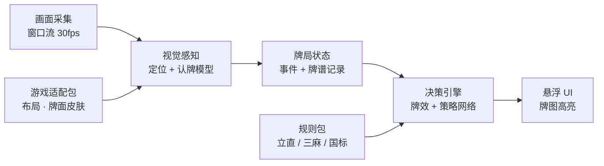

# 麻将 Copilot 设计方案

## 需求

1. 实时监控屏幕上的麻将牌：自己的手牌，以及自己和对手打出过的牌
2. 根据当前牌局给出打牌建议：打哪张，要不要吃、碰、杠
3. 短期适配日本麻将（雀魂、雀姬），长期适配任意三人 / 四人麻将游戏，包括网页版和 Steam 单机版
4. 不操作游戏，只给建议
5. 速度快，在出牌时限内尽早给出建议
6. 界面友好易用
7. 界面实时显示手牌图像和建议（直接标出哪张牌、吃碰杠），而不是用文字
8. 界面实时显示可能胡 / 建议胡的牌型，最多 3 种
9. 开箱即用，不需要繁琐的专业配置
10. 优先离线运行
11. 从每局开局起完整记录对局事件（mjai 格式的牌谱），作为预测的依据；牌谱保存在本机，可用于复盘

运行平台：先做 macOS，P2 加入 Windows。

## 一、核心思路

只读屏幕像素：不读游戏内存，不抓网络包，也不注入游戏进程。

已有的开源日麻助手（如 MahjongCopilot、Akagi）走的是网络中间人路线：要装证书、配代理，而且每款游戏都得单独解析协议。这和"开箱即用"、"适配任何麻将游戏"两条需求冲突。纯视觉方案的代价是要自己做好识别，换来三点好处：游戏无关、零配置、不碰游戏程序。

## 二、总体架构



- 应用基于 Tauri 2。采集、感知、状态、决策四段都在同一个 Rust 进程里运行；界面是网页视图，只接收建议结果，画面本身不经过网页。
- 全部在本地运行。
- 游戏适配包和规则包可以替换，接入新游戏只加包，不改核心。

## 三、模块设计

### 1. 画面采集

- 只捕获游戏窗口（Steam 客户端或浏览器窗口都行）：macOS 用 ScreenCaptureKit，Windows（P2）用 Windows.Graphics.Capture。Rust 里按平台各写一个实现，对上层提供同一个接口。我们自己的悬浮窗不会被采进去，所以叠加显示不会干扰识别。
- 以 30fps 采集，但先做变化检测（各区域缩略图做差分），画面没变就不推理，空闲时几乎不耗电。
- 坐标统一换算成相对窗口的比例，窗口缩放、Retina / 高分屏、全屏切换都不需要用户重新设置。

### 2. 视觉感知：传统算法定位 + 现成的认牌模型

不训练识别模型，产品里也不用 VLM。"牌在哪里"用传统算法；"这是哪张牌"交给现成的雀魂认牌模型 pjura/mahjong_soul_vision，赤五按笔画颜色判断，认出的结果在运行时缓存成模板。这个方案来自认牌方案评测（#24，[vlm-eval.md](vlm-eval.md)）：开源小型 VLM 最好也只有约 40%，在线 API 附对照表也只有约 80%，都不采用。

| 层 | 做什么 | 怎么做 |
|---|---|---|
| 画面配准 | 去掉浏览器边框，把游戏画面统一成标准尺寸 | 参考 cvmaj：拿适配包里的一张标准截图做特征点匹配，算出缩放和平移。窗口大小不变时只做一次 |
| 版面定位 | 知道手牌、四家牌河、副露、宝牌指示、按钮、分数各在哪里 | 适配包里的区域模板（标准尺寸下的坐标）；牌河这类有透视的区域先做透视校正，再按牌位切开，并判断每张牌是竖放还是横放 |
| 变化检测 | 找出这次哪些牌位变了 | 按牌位比较前后两帧，只把变化的牌位往下送 |
| 认牌 | 这个牌位上是哪张牌 | 先查运行时模板缓存；没命中，就把这张牌的小图交给认牌模型（34 类）；认出是五时，再按笔画颜色判断是不是赤五，得到 37 个牌名（34 种牌 + 3 张赤五）之一，存进缓存 |
| 数字和按钮 | 局数、本场、余牌数、分数；吃 / 碰 / 杠 / 和 / 立直按钮 | 不用 VLM，也不训练模型；具体方法在 #9 里评测后再定（候选：模板比对、系统自带的离线识字、开源的小型 OCR 模型）。按钮先用颜色检测快速发现；出现了哪些按钮，可以先由状态引擎推出的合法动作缩小范围。按钮一出现，就是"该做鸣牌决定了"最可靠的信号 |

运行时模板缓存：

- 同一款游戏、同一套牌面、同一个窗口大小下，同一种牌的画面几乎一模一样。认牌模型认出一张牌后，就把这张小图存成模板；同一种牌以后再出现，直接按像素比对，几毫秒就够，不再调用模型。
- 一局下来 37 种牌很快都会有模板，之后几乎都走这条快速路径。这只是缓存，不算训练。
- 缓存按"游戏 + 牌面 + 窗口大小 + 区域种类（手牌、牌河……）"分组；比对分数不够高时，退回认牌模型重新认。
- 比对方式（#4）：把牌图缩成 24×32 的小图，按每个通道的平均像素差比较，允许上下错开约五分之一张牌（悬停上浮）、左右错开一个像素。差值不超过 12，而且比其他任何牌的模板都至少近 8，才算命中。阈值用 10 张真实截图标定：同一种牌的差值中位数 2.8，不同的牌从没低于 13.1。
- 实测（#4）：真实截图上，整手 14 张都命中缓存时只要 0.5 ms；上浮 14% 的牌 132 张里 130 张命中，另外 2 张退回认牌模型，全部认对，没有一次命中出错。多源模拟中，缓存和认牌模型不一致的 7 次都是缓存对（模糊的牌命中了之前清楚时存下的模板）；唯一一次命中出错，是认牌模型以 0.95 的置信度认错后存下的模板，模型自己同样会认错。
- 开局（`start_kyoku`）时做一次完整识别：手牌、宝牌、局数和点数。这时离第一次打牌还有几秒，时间够用。

"不确定"标记（#4）：

- 牌宽不到 28 像素，或认牌模型的置信度低于 0.7 时，标为"不确定"：界面照常显示最可能的结果，加"?"角标；这张牌不存进缓存。牌太小时，界面还要提示用户把窗口调大。
- 两个阈值在评测数据上选定：多源模拟里，认牌模型的 76 次认错标出了 71 次，真实截图的 132 张牌一张也没有被误标。阈值是在评测数据上选的，还要用新截图验证。

认牌模型和赤五规则：

- 模型：[pjura/mahjong_soul_vision](https://huggingface.co/pjura/mahjong_soul_vision)，ViT-base 图像分类器（Apache-2.0），由原作者用 [pjura/mahjong_souls_tiles](https://huggingface.co/datasets/pjura/mahjong_souls_tiles) 训练，不是我们训练的。它只认 34 种牌，没有赤五类别。注意：数据集说明页链接的 pjura/mahjong_vision 是一个决定打哪张牌的小网络，不是认牌模型。
- 赤五规则：普通的五都有非红色的笔画（5 万的黑色"伍"、5 筒的黑色圈、5 索的绿竹子），赤五只有红色。只看牌面中间部分，非红色笔画占全部笔画的比例低于 0.25 就判为赤五。牌图太小（宽度不到 28 像素）时整张牌都标为"不确定"。
- 评测结果：在 10 张来源独立的真实截图（132 张手牌，含 4 张赤五）上全部正确；在 2640 张多源模拟手牌上 97.1%，窗口宽度 ≥ 960 像素时 100%。132 张全对时，95% 置信区间的下限是 97.2%；要证明 ≥ 99.5%，还需要约 600 张来源独立的真实牌。
- 使用条件：游戏窗口宽度至少约 960 像素。更小时索子之间、5 和 9 之间开始混淆，界面提示用户把窗口调大。
- 运行（#4 实测）：PyTorch 权重转成 ONNX，在 Rust 里用 ONNX Runtime 在 CPU 上推理。预处理（Pillow 的双线性缩放）和赤五规则都按原算法逐步移植，在 2989 张牌上和 PyTorch 的结果完全一致。
  - 单张约 33 ms，整手 14 张约 350 ms，加载约 0.1 秒，内存约 0.9GB；
  - 不用 CoreML：它不接受可变的批大小；固定批大小时，首次加载要编译 70–110 秒，整手也只快一倍；
  - int8 量化版只有 88MB、稍快一点，真实截图上同样全对，但在数据集测试部分多错一张。用不用它待定。
- 下载：模型约 343MB，首次启动时下载。它是用雀魂截图训练的，有版权灰色地带，所以不由我们转存分发，尽量从原作者的仓库下载；具体格式和转换方式在 #4 里定。
- 退路：遇到分类器认不准的皮肤或游戏，让分类器先猜出 37 张模板，由用户在界面上确认或改正一遍，之后全走模板比对。这样仍然不需要训练。

鲁棒性处理：

- 稳定帧门控：各区域连续 2–3 帧一致才认定结果。摸牌飞行动画、鸣牌特效、雀魂的角色立绘这类帧直接跳过。
- 鼠标悬停时手牌会上浮，按牌位切图时要容忍几个像素的位移。
- 宝牌有闪光动画（cvmaj 的经验）：模板比对要能容忍闪光，或者避开闪光帧取样。
- 认牌模型也会认错：用分类置信度和快照规则交叉检查，比如每种牌最多 4 张、雀魂四麻每种花色只有一张赤五（同时认出两张赤五筒，说明至少一张错了）。拿不准时在界面上显示"?"角标。

评测集：

- 用游戏里的牌谱回放录屏。牌谱本身就是标准答案，能自动得到大量带答案的画面，用来测识别准确率和事件推断是否正确，不用于训练。
- 截图、录屏，以及 pjura/mahjong_souls_tiles 这类外部数据集，都只在本机用于评测，不提交到仓库，也不随 app 分发。这些图片都是雀魂的游戏美术，数据集上标的 Apache-2.0 不能真正授权游戏美术本身。

### 3. 牌局状态引擎：从画面到 mjai 事件

画面只能给出一帧帧的局面，而 Mortal（通过 libriichi）只接受 mjai 事件序列。抓网络数据的工具（如 Akagi）能直接拿到事件；我们要自己从画面推出来。状态引擎就负责这一步：

```
逐帧识别（每张牌带置信度）→ 等画面稳定 → 局面快照
  → 事件推断（比较前后两张快照）→ mjai 事件
  → libriichi 维护牌局状态（同时检查事件是否合法）→ Mortal 和规则层
```

局面快照包括：自家手牌和刚摸的牌、四家牌河（打牌顺序和横放标记）、四家副露（每组来自哪家）、宝牌指示、场风 / 局数 / 本场 / 供托、各家点数和立直棒、当前出现的动作按钮。

从开局起完整记录牌谱（需求第 11 条）：

- 牌谱是预测的依据。助手要在对局开始前打开，从开局起记录每一个事件；对局结束后，把整场的 mjai 牌谱保存到本机的应用数据目录，可用于复盘。牌谱只存在本机，不上传。
- 对局进行中才打开助手时，界面提示"建议在对局开始前打开"，并走下面"中途打开"的后备流程。

每种 mjai 事件在画面上的依据：

| mjai 事件 | 画面上的依据 | 难度 |
|---|---|---|
| 新一局开始（`start_kyoku`） | 局数显示、分数盘、宝牌区、配牌 | 容易 |
| 自家摸牌（`tsumo`） | 手牌右侧多出一张单独放着的牌 | 容易 |
| 他家摸牌（`tsumo`） | 画面上看不到；mjai 本来就用 `?` 表示，在他家打牌前补一条 | 容易 |
| 打牌（`dahai`） | 某家牌河末尾多出一张，牌河顺序就是打牌顺序 | 容易 |
| 摸切 / 手切（`dahai` 的 `tsumogiri` 字段） | 自家一定知道；他家要追踪打出的牌是从手牌最右端还是中间出去的动画 | 难 |
| 吃、碰、明杠（`chi` / `pon` / `daiminkan`） | 某家副露区多出一组牌，横放的那张指明来源；来源家牌河末尾那张同时消失 | 中等 |
| 暗杠、加杠（`ankan` / `kakan`） | 副露区的变化，暗杠有两张牌背朝上 | 中等 |
| 翻新宝牌（`dora`） | 宝牌区多出一张指示牌 | 容易 |
| 立直（`reach` / `reach_accepted`） | 牌河出现横放的牌，加上立直棒 | 容易 |
| 和牌、流局、一局结束（`hora` / `ryukyoku` / `end_kyoku`） | 结算画面 | 中等 |

推断规则：

- 按行动顺序排序：两帧之间可能发生好几件事（动画很快、漏帧、有人鸣牌），用逆时针的行动顺序和牌河里的顺序把它们排好。有人鸣牌时，中间的玩家会被跳过。
- 只在画面稳定后才生成事件：摸牌和打牌的动画、鸣牌特效、角色立绘遮挡牌桌时都不推。
- 自我校验和重新同步：每一帧都拿"由事件推出的局面"和"画面上的快照"对照，不一致（比如之前认错一张牌）就按当前快照重建历史，不让错误累积。漏帧导致某个事件推不出来时，同样按快照重新同步，并在牌谱里标出这个缺口。libriichi 收到不合法的事件会直接报错，作为第二道检查。快照本身还要满足这些规则：
  - 每种牌最多 4 张；
  - 手牌张数 = 13 − 3 × 副露数（摸牌时再 +1）；
  - 牌河只增不减（被鸣走的牌除外）；
  - 宝牌指示只在杠之后增加。
- 中途打开程序（后备）：从当前快照补出一段合理的历史，按牌河顺序和行动顺序交替生成各家的打牌事件，副露按位置插进去，并在牌谱里把这一段标成"补出的"。这时 Mortal 的建议可能偏弱，界面上会提示。
- 他家的摸切 / 手切：Mortal 的输入编码用到了这项信息，包括每家最近一张手切的牌，但从画面上很难判断。先统一当作手切处理，接入 Mortal 时（#22）实测影响有多大；以后可以通过追踪动画帧来判断。
- 拿不准的牌：在 UI 上加一个"?"角标，先按最可能的结果计算，用户点一下就能改。

### 4. 决策引擎（两层叠加）

规则和搜索层：结果确定、可以解释，所有麻将规则都能用，是兜底。日麻的向听、和牌判定、番符和点数直接复用 Mortal 的 libriichi（放在 `third_party/libriichi`），它还带有单人期望值计算（每种打法的听牌率、和牌率和期望得点），以后做打牌排序和目标牌型时可以用上。

- 向听数（查表法，微秒级）
- 有效进张，扣掉场上已经看得见的牌
- 役和番符计算、打点估算
- 用蒙特卡洛估算和牌概率
- 防守：现物、筋、壁、one-chance、每张牌的危险度
- 推还是退：比较期望得点和放铳损失
- 吃、碰、杠的判断，就是对比"鸣"和"不鸣"两个分支各自的速度 × 打点 × 安全度

神经策略网络（日麻的主力）：采用 Mortal，不自己训练。输入牌局状态，输出每个可选动作的评分，单次推理在 10ms 以内。

- 模型：Mortal v4 结构（192×40，约 1083 万参数）。Mortal 作者本人不发布权重，所以权重用 Hugging Face 上的 haor/Mortal-S42（Apache-2.0，43.7 MB）。调研的候选里它许可最清楚，强度和社区里最强的 Mortal 权重基本持平。
- 输入编码：直接复用 Mortal 的 libriichi（Rust），从 mjai 事件生成 1012×34 的观测和 46 维的合法动作掩码，和原实现一致由构造保证。libriichi 是 AGPL-3.0，所以整个项目以 AGPL-3.0 开源，我们接受这一点。
- 推理：转成 ONNX，在 Rust 里用 ONNX Runtime 推理，并用对照测试保证和原 PyTorch 模型的输出一致。实测同结构的模型在 CPU 上约 7ms，走 CoreML 反而要 21ms，所以决策模型用 CPU。
- 范围：只支持四麻，三麻先只靠规则层。

两层怎么合作：网络负责给动作排序；规则层负责合法性过滤，并提供界面上显示的数字（进张数、危险度、目标牌型）。三麻、国标、四川这类暂时没有网络模型的规则，只靠规则层也能给出靠谱建议。

### 5. 目标牌型（最多 3 种）

1. 从当前手牌出发，在"最多再换 向听数+1 张牌"的范围内，用拆解树搜索枚举所有能和的 14 张组合，边搜边剪枝。
2. 每个组合算两个数：成牌概率 P（看剩余牌数和剩余巡数）、打点 V。
3. 按役种路线分组，比如立直平和、一气通贯、混一色、七对子、对对和。每组只留 P × V 最高的一个，再取前 3 组。
4. 听牌之后切换成"听牌视图"：每张待牌都显示和了后的完整牌型、剩余几张、多少点。
5. 向听数 ≥ 3 时只显示大方向（染手、七对、役牌速攻），不显示具体牌型，以免误导。

### 6. UI 设计

面板从上到下分四块：

| 区块 | 内容 |
|---|---|
| 状态栏 | 识别状态灯、游戏名、局数和本场数、余牌数、宝牌指示牌 |
| 手牌 | 13 张手牌 + 摸到的牌。建议打出的牌红框上浮并带向下箭头；第 2、3 候选在牌下方用色条表示 |
| 鸣牌提示 | 只在对手出牌时出现：对手打出的牌 → 推荐动作（大号 ✓，例如"碰"加上组成的面子）；不推荐的动作灰掉 |
| 目标牌型 | 最多 3 行。每行是完整的 14 张小牌图，还缺的牌用虚线框；右侧是役种标签、点数和成牌概率条 |

示例（自家东 2 局，摸到北）：

- 手牌 1–8 万、3 4 筒、5 索、中中，摸北 → 建议打北，第 2、3 候选为 5 索、3 筒
- 目标牌型
  - A：立直 · 一气通贯，缺 9 万和 5 筒，5200 点，28%
  - B：立直，缺 6 万和 5 筒，1300 点起，41%
  - C：混一色 · 一通 · 中，缺 9 万、中、2 万 ×2，8000 点，9%
- 对家打出中 → 推荐碰

设计要点：

- Tauri 窗口 + 网页界面（React + TypeScript）：无边框、置顶、半透明。mac 上做成不抢焦点的面板（用社区插件 tauri-nspanel，或少量原生代码），点它不会抢走游戏窗口的焦点。
- 两种模式：
  - 侧栏模式：自动吸附在游戏窗口旁边。
  - 叠加模式：一层透明、鼠标可以穿透的覆盖层，直接在游戏画面上给建议的那张牌画红框。它只负责画框，不操作游戏。
- 牌面用程序自带的高清 SVG 牌图，不用截图裁剪，所以清晰一致，而且万红、筒蓝、索绿颜色分明。牌图来自 lietxia/mahjong_graphic（M+ 字体许可，可修改、可商用、可再分发），不用其中的「雀魂样式」文件夹；牌背自己画。
- 信息分层：主建议用红框加箭头，扫一眼就能看到；第 2、3 候选用色条表示；鸣牌提示只在对手出牌时弹出，用大号 ✓ / ✗；有人立直后，手牌下方加一排危险度色条（绿/黄/红）。
- 识别状态灯：绿色表示正常，黄色表示有拿不准的牌，红色表示画面丢失。
- 快捷键（⌥ Space）显示/隐藏，有紧凑模式（只显示一行手牌），支持深浅色主题和中日英三种语言。

## 四、实时性

雀魂每手的基础思考时间只有几秒，所以按"画面稳定后 300ms 内出建议"来设计。下表是延迟预算：

| 环节 | 预算 |
|---|---|
| 等下一帧（30fps） | ≤ 33 ms |
| 稳定帧确认（2 帧） | ~66 ms |
| 认牌 | 命中模板缓存时整手约 0.5 ms；没命中时调用认牌模型，单张约 33 ms（Rust + ONNX Runtime，CPU 实测） |
| 状态更新 + 校验 | < 1 ms |
| 决策（规则 + 网络） | 5–15 ms |
| 目标牌型 | < 30 ms（大多已预先算好） |
| 界面渲染 | ≤ 16 ms |
| 合计 | 命中缓存时约 150 ms，P95 < 300 ms |

画面全程在 Rust 进程里处理，不跨进程拷贝；发给界面的只是几百字节的建议结果。

只有第一次遇到某种牌时要调用认牌模型，会慢一些；一局里 37 种牌很快都会进缓存。开局的完整识别把整手牌一次批量推理（Rust 实测约 350 ms），在第一次打牌前就能完成，不占用打牌时的预算。

提速的关键是预计算：

- 对手思考的时候，后台把"下一张可能摸到的 34 种牌"对应的打牌建议都算好；
- 对手一打出牌，马上算好吃/碰/杠/荣和该怎么选。

这样按钮一出现，建议基本同时出现，用户感受到的延迟只剩识别那一段。

## 五、开箱即用 + 离线

- 不加入 Apple Developer Program（不交年费）：app 用自签名证书签名，用 Tauri 的打包工具打成 DMG，拖进"应用程序"即可。
- 模型联网下载：识别模型和决策模型都不放进安装包，也不提交到 GitHub。首次启动时联网下载，从固定版本的地址获取并校验哈希，存在本机的应用数据目录。下载完成后运行不再需要联网。安装包本身约 100MB，牌图和适配包内置。
- 首次打开：因为没有经过苹果公证，系统会拦截一次。用户在"系统设置 → 隐私与安全性"底部点"仍要打开"并确认，之后就能正常使用。app 被拦截时自己还没运行，所以这三步说明画在 DMG 窗口的背景图上，下载页也写一份。
- 始终用同一张自签名证书签名（不用临时签名），这样屏幕录制权限能跨版本保留。证书导出为 .p12 备份，丢了的话所有用户都要重新授权。
- 以后想去掉首次打开这一步，再加入 Apple Developer Program（个人即可，每年 99 美元），换成开发者证书签名并公证。代价是所有用户需要重新授权一次屏幕录制。
- Windows（P2）：安装包没签名时 SmartScreen 会拦一次，用户点"更多信息 → 仍要运行"即可，下载页写明这一步。
- app 启动后的引导四步：
  1. 授权屏幕录制（有动图指引）；
  2. 下载模型：显示进度，可以断点续传，下载完校验哈希；已经下载过就跳过；
  3. 自动找到游戏窗口：按应用名、窗口标题、浏览器标签页标题匹配雀魂、雀姬等，找不到就让用户在窗口缩略图里点选；
  4. 开始。
- 自动识别：哪款游戏（视觉特征）、三麻还是四麻、有没有赤宝牌、窗口大小、牌面皮肤。
- 不需要：代理、证书、浏览器插件、Python 环境、账号登录。
- 离线运行：认牌和决策推理都在本机完成。除了首次下载模型和用户手动开启的"检查更新"，运行时不发任何网络请求，截下来的画面不离开电脑。
- 系统要求：
  - macOS 14+，Apple Silicon 优先。Intel Mac 也能跑，但延迟会高一些。
  - 认牌模型运行时约占 0.9GB 内存（ONNX Runtime 实测）。
  - Windows 10（1903 及以上）；推荐 Windows 11，可以去掉采集时的黄色边框。

## 六、从雀魂到"任意麻将游戏"

把差异收进两类可替换的包里，核心代码不用改：

- 游戏适配包：区域模板、一张用于画面配准的标准截图、按钮文字、窗口匹配规则，就是一个 JSON 加少量图片。牌面不用预先准备，运行时由认牌模型认出并缓存；认牌模型认不准的游戏，由用户确认一遍模板。接入一款新游戏就加一个新包。
- 规则包：
  - 牌的组成：花牌、三麻去掉 2–8 万；
  - 手牌张数：台湾麻将 16 张；
  - 可以鸣的动作：四川麻将不能吃；
  - 和牌条件：国标 8 番起和，四川缺一门、血战到底；
  - 计分方式。
- 平台：平台差异只有采集、推理加速、窗口行为三处，都封装在 Rust 的平台模块里。mac 先行，Windows 在 P2。
- 终点：接入没有适配包的新游戏时，让用户在一张截图上框出手牌、牌河等区域，自动生成适配包；至少能退一步给出"手牌牌效建议"。
- 新皮肤：认牌模型只用 2023 年雀魂默认牌面的截图训练过，其他皮肤要先评测；认不准时退回用户确认模板，运行时模板缓存再按新牌面重新建立。

## 七、技术栈

| 层 | 选型 |
|---|---|
| 应用框架 | Tauri 2 |
| 界面 | React + TypeScript + Vite，运行在系统网页视图里（mac：WKWebView；Windows：WebView2） |
| 采集 | Rust 平台模块：ScreenCaptureKit（mac）/ Windows.Graphics.Capture（Windows） |
| 推理 | ONNX Runtime（Rust 绑定 ort）。决策模型用 CPU（实测比 CoreML 快）；认牌模型用 CPU 还是 CoreML，以 #4 的实测为准 |
| 状态 + 决策 | Rust crate，和界面、平台无关 |
| 模型 | 不训练任何模型，不用 VLM。认牌用现成的 pjura/mahjong_soul_vision（Apache-2.0）加赤五颜色规则；决策用 Mortal（haor/Mortal-S42 权重）。都转换为 ONNX |

为什么选 Tauri 2：

- 原生 Swift 在 mac 上最快、最省资源，但以后做 Windows 要重写界面和采集。
- Electron 只统一了界面：采集、推理加速、识字仍要写原生插件；还要多带一个 Chromium（安装包大 100MB 以上，内存占用高）；每帧画面也要多次跨进程拷贝。
- Tauri 2 的界面同样用网页写，但整条流水线留在 Rust 里，安装包只多几 MB，也和本来就规划的 Rust 核心一致。
- 代价：mac 上的透明窗口要开启私有 API 选项（只影响上架 App Store，我们本来就不上架）；不抢焦点的面板要靠社区插件；两个平台的网页引擎不同，界面要两边都测。

## 八、分阶段计划（按 1–2 人估算）

| 阶段 | 周期 | 内容 |
|---|---|---|
| P0 原型 | 3–4 周 | 雀魂网页版四麻（macOS）：Tauri 工程搭建，认牌方案评测，用现成的认牌模型 + 赤五规则 + 模板缓存认出手牌，规则引擎（向听、进张），侧栏 UI 标出打哪张 |
| P1 MVP | 再 6–8 周 | 牌河、副露、宝牌全部识别，状态引擎和完整牌谱记录，鸣牌和立直建议，基础防守，目标牌型，叠加模式，首次启动引导 |
| P2 | 再 2–3 月 | 接入 Mortal 策略模型（四麻），雀姬，三麻，Steam 客户端，Windows 支持 |
| P3 | 长期 | 国标、四川、广东、台湾等规则包，用户框选一次就生成新游戏的适配包 |

## 九、风险

- 游戏规则：雀魂等在线游戏的用户协议一般禁止对局中使用辅助工具。只读屏幕的技术检测风险低，但在段位场里用仍然算违规，可能被封号，对真人对手也不公平。产品定位为练习和学习：AI 对战、友人房、牌谱复盘，再加一个"延迟揭示"学习模式（玩家先自己出牌，再显示 AI 的选择）。
- 识别出错会导致建议出错：靠状态灯、点击纠正、拿不准时降级处理来兜住。
- 认牌模型：
  - 132 张真实牌全对，只能说明准确率的下限约 97.2%。要证明 ≥ 99.5%，还要收集约 600 张来源独立的真实牌；
  - 它只用 2023 年雀魂默认牌面的截图训练过，其他皮肤、雀姬等其他游戏都还没测，认不准时退回"用户确认模板 + 模板比对"；
  - 窗口宽度低于约 960 像素时会认错；
  - 权重的许可是 Apache-2.0，但训练数据是游戏截图，有版权灰色地带。所以由 app 从原作者的仓库下载，不由我们转存分发。
- 模型下载源：Hugging Face 在部分地区访问慢或不可用，需要提供镜像地址（比如 ModelScope 上的同版本文件），无论从哪里下载都校验同一个哈希。
- 牌谱要从开局记录：对局中途才打开助手时，历史是补出来的，建议可能偏弱。
- 从画面推事件，比直接读网络数据多两种出错的可能：认错牌、推错事件。靠每帧对照快照、不一致时重新同步来兜住。他家的摸切 / 手切难以拿到，会让 Mortal 对他家手牌的判断变弱，影响大小在 #22 里实测。
- 许可和模型来源：
  - 用了 Mortal 的 libriichi（AGPL-3.0），项目以 AGPL-3.0 开源，已接受；
  - Mortal-S42 的上传者是匿名账号。它的基础模型是不是从没有许可的权重续训来的，还要向上传者 haor 确认；
  - 所有能用的 Mortal 权重都是用天凤牌谱训练的，而天凤条款不允许把牌谱用在不需要天凤对战的服务上。权重许可本身清楚，但训练数据这一层有风险。随 app 分发前，要决定是否先向天凤运营方 C-EGG 询问；
  - 如果最后不能用，决策先只靠规则层。
- 游戏更新改了界面：适配包支持更新，离线时也能手动导入。
- 未经苹果公证：
  - 每个从浏览器下载的新版本都要再点一次"仍要打开"，以后可以用应用内更新缓解；
  - 签名在打包过程中被破坏时，用户会看到"已损坏"提示。所以签名放在构建的最后一步，发布前先在另一台 Mac 上验证。
- macOS 15 起系统会定期重新确认屏幕录制权限，引导里要写清楚这一点。
- 框架相关：
  - tauri-nspanel 是社区插件，失效时改用少量原生代码实现；
  - 两个平台的网页引擎不同（WKWebView / WebView2），界面要两边都测。
- Windows（P2）：
  - 独占全屏的游戏无法叠加显示，需要改用窗口化或无边框全屏，侧栏模式不受影响；
  - Windows 10 采集时，被采集的窗口会出现黄色边框，较新的 Windows 11 可以关掉。

## 十、验收指标

- 单张牌识别准确率 ≥ 99.5%，每巡牌局状态完全正确率 ≥ 98%。
- 牌谱：从开局到终局完整记录，能被 libriichi 完整回放。
- 从画面稳定到出建议，P95 < 300ms；空闲时 CPU 占用很低。
- 决策质量：在何切题集上和强 AI 的一致率；在模拟器里和基线 bot 对战的平均顺位。
- 首次启动到出第一条建议 < 1 分钟，全程零配置。
